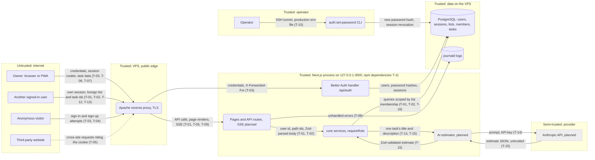

# Threat model: Taskly

**Scope:** whole system: the Next.js app (`packages/app` with `core` and `db`), its PostgreSQL database, the offline `auth:set-password` CLI, and the version 2 features already stubbed in `core` (invitations and roles, SSE live updates, AI estimates, shopping list)
**Last updated:** 2026-11-16
**Owner:** Taskly owner (product owner and operator)

Taskly is a web app (a PWA on phones) for planning home renovation tasks with cost estimates in PLN. Version 1 has a single user: the owner signs in with email and password and keeps tasks in one list. Version 2 adds list sharing with `owner` / `editor` / `viewer` roles, live updates and AI estimates. The data is low in value to strangers, but the account holds a household's plans and budget. Two threats matter most. First, someone takes over the owner's account through the public sign-in form (T-03). Second, once sharing ships, one user reads or changes another user's list: by id (T-01), by role (T-02) or through an invitation (T-12). The authorization layer that stops T-01 and T-02 exists and is tested today. Every new route has to keep it.

## 1. What are we working on?

### System profile

| Application | Type | Stack | Deployed as | Auth | Tenancy | AI |
| --- | --- | --- | --- | --- | --- | --- |
| `packages/app` (with `core`, `db`) | Browser web app, PWA, JSON API (Route Handlers), SSE planned | Next.js 16 App Router, React, TanStack Query, Zod 4, Drizzle, PostgreSQL | Standalone Node server under systemd on `127.0.0.1:3000`, behind Apache with Let's Encrypt TLS, on a 1 GB Ubuntu VPS | Better Auth 1.7 email + password, sessions in PostgreSQL, cookie (30-day TTL, renewed after 1 day); sign-up off unless `ALLOW_SIGN_UP=true` | Per list: a `list_members` row with a role; tasks inherit their list's role; non-members get 404 | Planned: Claude estimate of a task's cost (`core/src/ai.ts` is a stub) |
| `auth:set-password` | CLI, run by the operator | Node, `core` | Run from a dev checkout over an SSH tunnel to the VPS database | Database credentials from a private env file | n/a (one user by email) | none |

Architecture: a modular monolith. The browser talks only to Next.js. Route Handlers call `core` services, and those services authorize against the list membership before they touch data.
Data stores: PostgreSQL on the VPS (users, password hashes, sessions, lists, members, tasks, invitations, shopping items). Logs go to journald through systemd.
External systems: the Anthropic API (planned, server-side only, called with the operator's key). There is no email provider yet.
Multi-tenancy: there are no tenants. The list is the unit of access. `requireRole` (`packages/core/src/access.ts`) and `requireTaskRole` (`packages/core/src/tasks.ts`) resolve the caller's role from `list_members` inside the service transaction. A non-member gets `NotFoundError`, and an insufficient role gets `ForbiddenError`.

### Assets (what we protect)

- The owner's account and session. The account opens every list the owner has.
- Task lists: titles, descriptions, estimates, completion state. In version 2, also memberships and roles.
- Password hashes and session tokens in PostgreSQL.
- Secrets in the systemd `EnvironmentFile`: `DATABASE_URL`, `BETTER_AUTH_SECRET`, `ANTHROPIC_API_KEY`.
- Anthropic budget (planned).
- Availability of a 1 GB VPS shared by Node and PostgreSQL.

### Actors

| Actor | Access | Motivation |
| --- | --- | --- |
| Anonymous internet user | Sign-in and sign-up pages, `/api/auth/*` | Take over the owner's account, create an account while sign-up is open |
| Signed-in user who is not a member of the list (possible today if sign-up was ever open; normal in version 2) | Own lists only | Read or change another user's list or tasks |
| List `viewer` or `editor` (version 2) | One shared list | Write as a viewer; act as owner (invite, remove members, delete the list) |
| Third-party website visited by a signed-in user | The victim's browser | Make cross-site requests that ride the session cookie |
| Untrusted content the system reads (version 2) | Task text written by other list members; model output | Prompt injection into AI estimates; stored XSS |
| Compromised npm dependency | Build and runtime | Run code holding DB credentials and the API key |
| Operator with VPS access | Everything | Mistakes rather than malice: secrets copied off the VPS, sign-up left open |

### Entry points

| Application | Entry point | Auth required | Notes |
| --- | --- | --- | --- |
| app | `GET/POST /api/auth/[...all]` (sign-in, sign-up, sign-out, session) | no | Better Auth; rate limit per client IP, in memory (`packages/core/src/auth.ts:32`): sign-in 5 per 60 s, other paths per T-03; origin check against `BETTER_AUTH_URL` |
| app | `GET /`, `/sign-in`, `/sign-up` (pages) | `/` yes | `requireSessionUser` redirects to `/sign-in`; page reads never renew the session |
| app | `GET`, `POST /api/lists/{listId}/tasks` | yes | `requireRole` read / write; the POST body's `placeIds` (at most 20 UUIDs) resolve only to places of an owner of the list, locked with the task's write; any other id → 404 and nothing is written (#83) |
| app | `GET /api/lists/{listId}/future-expenses` | yes | `requireRole` read |
| app | `PATCH`, `DELETE /api/tasks/{taskId}`; `PUT /api/tasks/{taskId}/completion` | yes | `requireTaskRole` write; task → list → membership |
| app (planned) | invitations, member removal, list rename and delete, move, shopping, SSE stream, AI estimate | yes | Stubs in `core` throw `NotImplementedError`; no routes yet |
| CLI | `npm run auth:set-password -- --env-file <file> <email>` | DB credentials | Interactive TTY only; revokes all of that user's sessions |

### Data flow and trust boundaries

Boundaries: browser ↔ Apache (internet to host); Apache ↔ Next.js (the only trusted source of `X-Forwarded-For`); route handler ↔ `core` (the authorization line); app ↔ PostgreSQL; app ↔ Anthropic (planned); task text ↔ model context and model output ↔ stored estimate (planned); operator machine ↔ production database (CLI).
Diagram source: `.ai/docs/security/threat-model.mmd`. No Mermaid renderer is installed; GitHub renders the block above.

### AI components

| Component | Untrusted input | Sensitive data / systems | Changes state or sends externally | Rule of Two verdict |
| --- | --- | --- | --- | --- |
| AI estimator (planned, `core/src/ai.ts`) | Version 1: no (the owner's own text). Version 2: yes (task text written by any editor of a shared list) | Only if the prompt carries more than the one task being estimated. The standard (§7) forbids other users' data | Yes: writes an estimate that feeds future expenses. No tools, no links rendered from model output | 2 of 3 in version 2 (untrusted input + state change). Acceptable while the prompt holds only the one task. Keep it that way, and make the estimate a proposal the user accepts before it counts (T-15) |

### Assumptions and open questions

- [ ] The Apache vhost is not in the repository. Unknown whether it sets HSTS, `Content-Security-Policy`, `frame-ancestors` / `X-Frame-Options`, or `LimitRequestBody`. The runbook covers only `ProxyAddHeaders`.
- [ ] Unverified: does Better Auth 1.7.7 apply its built-in stricter per-path limit for `/sign-in/email` on top of the global `rateLimit: { window: 60, max: 30 }`? Check against the installed version.
- [ ] The standalone server runs with `NODE_ENV=production`, so `useSecureCookies` is on. Not checked against the production `Set-Cookie`.
- [ ] Not known: the privileges of the PostgreSQL role in `DATABASE_URL` (schema owner? superuser?) and whether, where and how database backups are stored and encrypted.
- [ ] One Node process. The in-memory rate limiter and the planned in-process SSE pub/sub assume this.
- [ ] Not designed yet: how invitations reach the invitee (no email provider), and whether AI estimates are stored directly or proposed for confirmation. T-12 and T-15 state the controls those designs need.
- [ ] Out of scope here: `experimental.agentFeedback` in `next.config.ts`. It affects only `next dev` and the agent instructions it writes into `AGENTS.md`, not the deployed server.

## 2. What can go wrong?

L = likelihood, I = impact (H/M/L). "Planned" rows describe a feature that is not built yet. Their response is a requirement on its spec.

| ID | Threat | STRIDE | Where | L | I | Response | Control today | How we verify | OWASP / CWE |
| --- | --- | --- | --- | --- | --- | --- | --- | --- | --- |
| T-01 | A signed-in user reads or changes another user's list or task by putting its id in the path (`/api/lists/{listId}/…`, `/api/tasks/{taskId}`) or in the body (`parentId` on create; `afterId`/`beforeId` on the planned move) | I, T, E | app: all `/api/lists` and `/api/tasks` routes; `core/src/tasks.ts` | L | H | Mitigate: every service resolves the record's list and calls `requireRole` in the same transaction; ids in a body are matched against the authorized list | `requireRole` / `requireTaskRole` return 404 for non-members; the `parentId` lookup is filtered by `listId` (`tasks.ts:231`) | Existing: `tasks-http` "answers 404 for another user's list or task", `tasks.integration` "reports a parent in another list…". New routes: the same two-account test. DAST: swap ids between two seeded accounts | A01:2025, API1:2023, CWE-639 |
| T-02 | A `viewer` writes, or an `editor` does an owner action (invite, remove a member, rename or delete the list), because a new route skips the role check or checks too weak an action | E | app: planned list and member routes; `core/src/authorization.ts` | M | H | Mitigate: services call `requireRole(…, action)` with the right action (`read`/`write`/`manage`), never a check in the route or UI | `can()` rank check; viewer tests on create, edit, complete, delete | A role-matrix integration test (owner / editor / viewer / non-member × every mutation) for each new route | A01:2025, API5:2023, CWE-285 |
| T-03 | Password guessing or spraying against `POST /api/auth/sign-in/email` takes over the owner's account. If Apache stops sending `X-Forwarded-For`, every client shares one bucket and a stranger can lock the owner out | S, D | app: `/api/auth/*`; `core/src/auth.ts` (`SIGN_IN_RATE_LIMIT`, `rateLimit`) | M | H | Mitigate: keep the strict sign-in limit; optional fail2ban on Apache's auth 401/429s (runbook); keep the 10-character minimum. A per-account limit is not added: it would let a stranger lock the owner out from any address (open for the owner, #77) | Sign-in: 5 attempts per 60 s per client IP (`customRules`; it replaces Better Auth 1.7.25's built-in 3 per 10 s for `/sign-in*`, confirmed from source); other auth paths: Better Auth's built-in rules, else 30 per 60 s; in memory, reset on restart; XFF trusted from loopback only; generic error messages; minimum length 10 | Existing: `auth-http` "answers the 6th rapid wrong sign-in … with 429", "refuses even the right password while limited and accepts it after the window", "logs that all clients share one bucket …". Operator: the runbook's journal check that Apache sends XFF; `ss -ltnp` shows only `127.0.0.1:3000` | A07:2025, API2:2023, CWE-307 |
| T-04 | `ALLOW_SIGN_UP=true` is left on after the owner's account is created, so anyone can register. They get only their own list but a foothold for T-01, T-09 and T-12 | S, E | ops: systemd `EnvironmentFile`; `auth.ts:23` | M | M | Mitigate: post-deploy check that sign-up is refused; the warning stays in the log | Off by default; warning logged; runbook removes the line after bootstrap | `auth-browser-closed` / `auth-http` tests; a post-deploy probe of `POST /api/auth/sign-up/email` expecting refusal | A07:2025, CWE-284 |
| T-05 | A third-party page makes a signed-in user's browser send a state-changing request (delete a task, sign out, sign in as the attacker) | T | app: `lib/api.ts:55`, `/api/auth/*` | L | M | Mitigate: keep all three layers | SameSite=Lax cookie; custom `x-requested-with: taskly` header on every `/api` mutation (needs a CORS preflight that is never granted); Better Auth origin check (`trustedOrigins`) | Existing: `tasks-http` "rejects every mutation without the CSRF header". DAST: cross-origin POST to `/api/auth/sign-in/email` and `/sign-out` is refused | A01:2025, CWE-352 |
| T-06 | A stolen session cookie (shared device, malware, sniffing on a first plain-HTTP visit without HSTS) stays valid up to 30 days. The user cannot sign out other devices; only the offline CLI revokes all sessions | S | app: `auth.ts:51`; Apache | L | H | Mitigate: HSTS at Apache; add "sign out everywhere" before sharing ships. Accept the 30-day TTL for version 1 | HttpOnly cookie, Secure in production, sessions in DB, sign-out deletes the row, the CLI revokes all | Check the production `Set-Cookie` flags and the `Strict-Transport-Security` header; existing test "answers 401 … with a stale cookie" | A07:2025, CWE-613 |
| T-07 | Markup in a task title or description runs as script in another member's browser (version 2), or a later change introduces an unsafe sink | T, E | app: task rendering; `next.config.ts` headers from `lib/security-headers.ts` | L | H | Mitigate: keep React text rendering; CSP and framing headers on every response (#79). Accepted for version 1: inline `<script>` elements **and `javascript:` URLs** stay allowed (`script-src-elem 'self' 'unsafe-inline'`; CSP3 checks `javascript:` navigations against it), because with Cache Components Next writes its inline scripts into the prerendered shell at build time, where no nonce reaches them and no hash can list them. Only inline event handlers and `eval` are refused. So markup from a raw-HTML sink still runs script: `<a href="javascript:…">` on click, `<iframe src="javascript:…">` with no click (`frame-src 'none'` does not stop it); React 19 blocks `javascript:` URLs only in attributes it renders itself. Browsers without CSP3 `script-src-attr` (Safari < 15.4, Firefox < 108) fall back to `script-src 'self' 'unsafe-inline'` and run inline handlers too. A nonce-only `script-src` needs every page rendered per request; revisit before sharing ships | React escapes; `react/no-danger` is a lint error outside the static theme script (`components/shell/theme-script.tsx`), on DOM elements and custom components; `no-restricted-properties` refuses `innerHTML`, `outerHTML`, `insertAdjacentHTML`, `setHTMLUnsafe`, `parseHTMLUnsafe` and `createContextualFragment`, and `no-restricted-syntax` refuses `write`/`writeln` on `document`, `window.document` or any `ownerDocument`, outside `*.test.*` files. Not covered by lint: sinks reached through a computed name (`el["inner" + "HTML"]`), `document.write` through any other reference (`const d = document; d.write(…)`, `document.open().write(…)`, an iframe's `contentDocument`), `DOMParser`, `Range` methods other than `createContextualFragment`, `iframe.srcdoc` (property or `srcDoc` prop), and raw HTML inside third-party packages; CSP `default-src 'self'`, no inline event handlers (`script-src-attr 'none'`, CSP3 browsers), no `eval`, `object-src 'none'`, `base-uri 'self'`, `form-action 'self'`, `frame-ancestors 'none'`; `X-Frame-Options: DENY`, `X-Content-Type-Options: nosniff`, `Referrer-Policy: same-origin`; length limits in Zod | Existing: lint; `app.integration` checks the headers on a page, a redirect and an API response, and that an injected inline handler is refused; every browser suite fails on a CSP violation. DAST in the test env: a title with HTML markup renders as text | A05:2025, A02:2025, CWE-79, CWE-1021 |
| T-08 | An unhandled database error (deadlock, serialization failure, lost connection, a constraint `translateDbError` does not map) used to be logged whole by `console.error("Unhandled API error", error)`. A `DrizzleQueryError` carries the SQL params: task titles, descriptions, user ids | I | app: `lib/api.ts` (`logFailure`), `lib/default-list.ts`, `lib/log-error.ts` | M | L | Mitigated (#76): log only the method, route path, error class and pg `code` | `describeError` (`lib/log-error.ts`) returns the class name and an identifier-like `code` from the error or its `cause`, never the message, params, query or `cause`; `apiHandler` and `openDefaultList` log one string line with it. The client gets a generic 500; `translateDbError` strips pg details for known codes; output-contract failures log no values | Unit test: `api.test.ts` "logs an unmapped DB error without its query, params or cause (#76)" throws a `DrizzleQueryError` whose params hold a marker; the marker never reaches `console.error` and the response stays the generic 500. `log-error.test.ts` covers the code and class-name filtering | A09:2025, CWE-532 |
| T-09 | A signed-in user exhausts the 1 GB VPS: unbounded task creation, an unpaginated `GET …/tasks`, request bodies the app does not cap, and later many SSE connections. An OOM takes down Node and PostgreSQL together | D | app: `/api/lists/{listId}/tasks`; planned SSE; Apache | L | M | Mitigate: `LimitRequestBody` at Apache; a cap on tasks per list; a per-user write rate limit; a per-user SSE connection cap | Zod length limits per field (title 200, description 2 000); DB pool of 5; sign-up off | Load test in the isolated env: bulk create, watch RSS; an oversized body gets 413; SSE connections over the cap are refused | API4:2023, CWE-770 |
| T-10 | The offline password reset runs on a dev machine, with production database credentials in an env file there and a tunnel to the production DB. A leaked file exposes them. Before #80 the file also held `BETTER_AUTH_SECRET` and `ANTHROPIC_API_KEY`, which work from anywhere | I | ops: `.ai/docs/runbook.md`; `core/src/cli/set-password.ts` | L | M | Mitigate (done, #80): the CLI validates and uses only `DATABASE_URL` (and the optional `DATABASE_POOL_MAX`) and gives Better Auth a throwaway secret; the runbook copies only the tunnel's `DATABASE_URL` and ends by deleting the file. Not chosen: running the CLI on the VPS, because the standalone artifact ships neither the CLI nor `tsx`, and installing the workspace there does not fit a 1 GB VPS | File outside the repo, `chmod 600`, deleted after use; it holds one URL for `127.0.0.1:5433`, which works only through the operator's SSH tunnel; interactive TTY only; the password is never echoed | `auth-set-password.integration` runs the command with an env file holding only `DATABASE_URL`; `set-password.test` "resets with an env file that holds only DATABASE_URL"; review the runbook | A02:2025, CWE-312 |
| T-11 | A compromised or vulnerable npm package (Next.js, Better Auth, Drizzle, Radix…) runs inside the server process with the DB credentials and the API key | T, E | build and runtime | L | H | Mitigate: keep the lockfile, `npm ci` and `npm audit` in the gate; review lockfile diffs; add few dependencies | One lockfile; `npm audit` in the gate; pinned majors | `npm run audit` in CI; periodic dependency audit | A03:2025, CWE-1395 |
| T-12 | Planned, invitations: a token is guessed or reused or never expires; it is accepted by someone other than the invitee; it grants `owner`. Emails are never verified (`emailVerified` stays false), so "the matching email" can be satisfied by registering the invitee's address first while sign-up is open | S, E | `core/src/invitations.ts` (stub); `invitations` table | M | H | Mitigate in the spec: ≥128-bit random token stored hashed; single use under a row lock; expiry; role limited to editor/viewer in `core`; accept requires the invitation's email to be verified, or rely on the token alone with a short expiry | Stub only; schema has a unique `token` and `expires_at` | Integration tests: expired, used, wrong-email and owner-role invitations are refused; two concurrent accepts give one membership | A01:2025, A07:2025, CWE-640, CWE-330 |
| T-13 | Planned, SSE: the live stream delivers events of lists the user cannot read, or keeps streaming after the member is removed or signs out | I | `core/src/events.ts` (stub); planned SSE route | M | M | Mitigate: authenticate on connect, check membership per event (re-check on `members` events), close the stream on removal, unsubscribe on close | Stub; standard §7 states the rule | Integration test with two users: an event on A's list never reaches B; a removed member's stream closes | A01:2025, CWE-200 |
| T-14 | Planned, AI: the estimate endpoint is called in a loop and runs up the Anthropic bill; the key leaks into a client bundle or a log | D, I | `core/src/ai.ts` (stub); planned route | M | M | Mitigate: per-user rate limit plus a daily spend ceiling; bounded `max_tokens`; timeout; key read only in `server-only` code | `ai.ts` is `server-only`; key validated in `env.ts`; standard §7 | Integration test: a burst of estimate requests gets 429; build check that the key name is not in `.next/static`; an Anthropic spend limit set on the key | LLM06:2026, API4:2023, CWE-770 |
| T-15 | Planned, AI: instructions inside a task's text (written by any editor of a shared list) steer the model into a misleading estimate, which then counts in future expenses and drives what the owner buys first; or malformed output gets stored | T | `core/src/ai.ts`; `aiEstimateResponse` | M | M | Mitigate: the prompt holds only that task, separated from instructions; output is `JSON.parse` + Zod (integer grosze, min ≤ max, ≤ `MAX_ESTIMATE_GROSZE`), invalid output stores nothing; the estimate is labelled as AI and the user accepts it before it counts | `aiEstimateResponse = estimateSchema` exists; nothing stored yet | Unit tests: invalid, oversized or non-JSON output is refused and nothing is written. Prompt-injection test in the test env: instruction-like task text still yields a schema-valid estimate and no other data | LLM01:2026, LLM07:2026, CWE-20 |
| T-16 | Once sharing ships, no one can tell who changed, completed or deleted a task: rows carry no actor, deletes are hard and cascade to subtasks, and no audit log exists | R | `db/src/schema.ts`; `core/src/tasks.ts` | M | M | Accept for version 1 (one user). Before sharing: record the actor on writes and keep an audit log of deletes and role changes | none | Schema review in the sharing spec; integration test that a delete by an editor records the actor | A09:2025, CWE-778 |

## 3. Test scope

The "How we verify" column, grouped by method.

| Method | What to try | Threats |
| --- | --- | --- |
| Integration tests (existing, keep green) | Cross-user 404 on every list and task route; viewer cannot write; foreign `parentId`; mutations without the CSRF header refused; stale cookie → 401; sign-up closed; sign-in rate limit → 429 | T-01, T-02, T-03, T-04, T-05, T-06 |
| Integration tests (to add) | Role matrix for each new route; invitation expiry, reuse, wrong email, owner role, concurrent accept; SSE event isolation and close on removal; estimate rate limit; editor delete records the actor | T-02, T-12, T-13, T-14, T-16 |
| Unit tests (existing, keep green) | `apiHandler` and `openDefaultList` never log DB params (`api.test.ts`, `default-list.test.ts`, `log-error.test.ts`) | T-08 |
| Unit tests (to add) | AI output validation stores nothing on bad output | T-15 |
| SAST / build checks | No new `dangerouslySetInnerHTML` (`react/no-danger`) or DOM raw-HTML sink (`no-restricted-properties`, `no-restricted-syntax`; T-07 lists what they miss); no API key in `.next/static`; `npm audit` | T-07, T-11, T-14 |
| DAST (no session, then user A's session against user B's ids) | Id swapping on `/api/lists/*` and `/api/tasks/*`; cross-origin POSTs to `/api/auth/*`; HTML markup in task text renders as text; response headers (CSP, HSTS, frame-ancestors); oversized body → 413 | T-01, T-05, T-06, T-07, T-09 |
| Manual, operator | Apache sends XFF; app listens only on loopback; production `Set-Cookie` flags; sign-up refused after deploy; the reset env file holds only the tunnel `DATABASE_URL` and is deleted after use | T-03, T-04, T-06, T-10 |
| Prompt injection (when AI ships) | Task descriptions with instruction-like text; check the estimate is schema-valid and nothing else is stored | T-15 |

**Out of scope:** infrastructure of the VPS provider, Let's Encrypt and Anthropic; volumetric DDoS; OS hardening of the VPS beyond the loopback bind; social engineering; the production deployment itself.

**Rules of engagement:** test only in a local or isolated test environment (the `test:integration` setup or the QA test env), never against production. Use synthetic data only: at least two users, each with their own list, plus seeded `editor` and `viewer` memberships. No real Anthropic key: use a stub estimator, or a key with a hard spend limit. Load tests run on a machine that is not the VPS.

**Re-run this model when:** a new route or entry point appears; auth, roles or sharing change; an integration is added (email, Anthropic); the AI estimator gets new inputs or tools; the deployment changes (another proxy, a second process).

## 4. Did we do a good job?

- [x] Every application in scope has a row in the System profile
- [x] Every entry point and every boundary crossing on the diagram was walked through all six STRIDE letters
- [x] Every AI component has a Rule of Two verdict
- [x] Every High threat has a mitigation and a verification
- [x] Cross-tenant (cross-list) and cross-role threats are present (T-01, T-02)
- [x] Threat IDs are annotated on the diagram's flows
- [x] Assumptions are marked, not presented as facts
- [x] The document contains no attack instructions, payloads or exploit code
- [x] Out of scope and rules of engagement are written down

## Changelog

- 2026-11-23 CSP, `X-Frame-Options`, `nosniff` and `Referrer-Policy` on every response, `react/no-danger` lint rule (#79); T-07 records the inline-script allowance Cache Components force
- 2026-11-23 T-07 corrected after review: the accepted gap also covers `javascript:` URLs (an injected iframe runs with no click) and non-CSP3 browsers; lint now refuses the DOM's raw-HTML sinks and `dangerouslySetInnerHTML` on custom components (#79)
- 2026-11-23 T-07 after re-review: lint also refuses `setHTMLUnsafe`, `parseHTMLUnsafe` and `document.write` through `window.document` or `ownerDocument`; the not-covered list names the references it still misses; the SAST row names the raw-HTML lint rules (#79)
- 2026-11-23 T-10 mitigated (#80): the password reset needs only `DATABASE_URL`, so the copied env file holds no app secret and is deleted after use
- 2026-11-23 T-03: sign-in limited to 5 attempts per minute per client IP, replacing Better Auth's built-in 3 per 10 s; the runbook checks that Apache sends XFF and describes an optional fail2ban jail; the sign-in 429 test moves to §3's existing tests (#77)
- 2026-11-16 Task creation takes `placeIds` (#83): another object type referenced by id in a body, scoped to the list owner's places
- 2026-11-16 Initial model (version 1 shipped: sign-in, tasks and subtasks, completion, future expenses, markers; version 2 features modelled from their `core` stubs)
