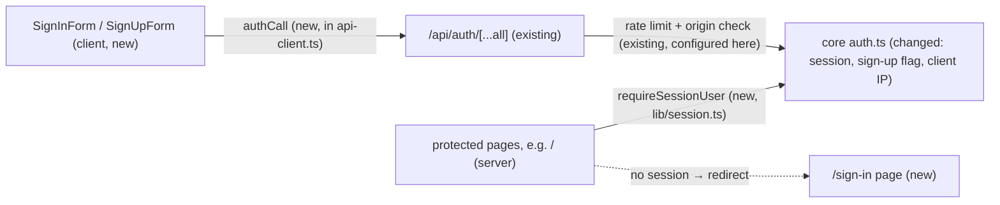

# Sign-up, sign-in and sign-out pages

- **Date:** 2026-10-16
- **Status:** draft
- **Issue:** #24 (Phase A), #25 (Phase B). This is the prerequisite (Phase 0) of `.ai/specs/2026-10-16-tasks-and-subtasks.md`, confirmed by the owner on 2026-10-16.

## 📝 TLDR

Every Taskly screen is for a signed-in owner, but today nobody can sign in from the browser. Better Auth is configured in `packages/core/src/auth.ts` and `/api/auth/[...all]` is mounted, but there are no pages, no sign-out, and nothing sends a signed-out visitor anywhere. This spec proposes (not yet built):

- English sign-up (name, email, password), sign-in and sign-out screens;
- a server-side guard that redirects signed-out visitors to `/sign-in`;
- sign-up closed unless the server enables it;
- 30-day sessions renewed while the app is used;
- a server-side script to reset a forgotten password.

It ships in two phases: **Phase A** (pages, guard, auth configuration) unblocks the tasks screen; **Phase B** (the password-reset script) follows independently.

## 📝 Problem Statement

- The tasks spec (step 8) redirects signed-out visitors to a sign-in page and needs a signed-in user. Neither exists.
- **Current code:**
  - `auth.ts`: email + password, minimum 10 characters, `rateLimit` on, `nextCookies()`, secure cookies in production, and `trustedOrigins = [BETTER_AUTH_URL]`.
  - `getSessionUser(headers)` and `requireUser(req)` exist. `page.tsx` is the Next.js starter page.
- **Risks:**
  - Auth is `risk-high` (`SDLC.md`).
  - Taskly is public on the VPS, but version 1 is for the owner alone (D02), so open sign-up would let strangers create accounts.
  - Any guard that runs only in the browser does not protect data.

## 📝 Proposed Solution

Decisions applied (owner, 2026-10-16):

| # | Decision |
| --- | --- |
| Q1 | Sign-up is **off by default**. `ALLOW_SIGN_UP=true` turns it on, through Better Auth's built-in `emailAndPassword.disableSignUp`. |
| Q2 | No email verification and no reset email in version 1. A server-side script sets a new password. |
| Q3 | English UI. Amounts keep Polish formatting. **Changed 2026-10-27 (owner, prototype map L04):** the product's target language is Polish, with a language switch later. The texts in this spec stay English for now, as in the design system and the prototype (DS06: English only for now). Translation and the switch need their own spec. |
| Q4 | Sign-up asks for a **name**. |
| Q5 | Sessions last **30 days** and are renewed while used. |

Decisions from the grilling session (owner, 2026-10-16):

| # | Decision |
| --- | --- |
| Q6 | Two phases. **Phase A**: auth configuration, schemas and sign-up hook, `authCall`, session guard, forms, pages, `createPasswordUser`. **Phase B**: `setPassword`, the reset CLI, `tsx`, and the reset Runbook. |
| Q7 | After sign-in or sign-up the user always lands on `/`. No return-to (`?next=`) parameter. |
| Q8 | Sessions are always persistent. No "Remember me" checkbox; `authCall` never sends `rememberMe` (Better Auth's default `true` applies). |
| Q9 | Accept Better Auth's sign-out behavior: it returns 200 and clears the cookie even when there is no session or when deleting the session row fails (the error is only logged). No custom sign-out wrapper. |
| Q10 | Password fields get a show-password toggle. |
| Q11 | The "sign-up is open" warning stays lazy: logged once, when auth first initializes (the first auth request), not at process start. |
| Q12 | `createPasswordUser` and the Drizzle adapter's `transaction: true` ship in Phase A, because the Phase A integration tests depend on them. |
| Q13 | No `auth:create-user` command. The owner account is created through the browser with the `ALLOW_SIGN_UP` Runbook steps. |
| Q14 | The reset CLI requires an interactive terminal and refuses piped input. Its smoke test drives it through util-linux `script`, not `node-pty`. |
| Q15 | Phase B gates nothing. It may ship any time after Phase A, including after the first production deploy. |

The owner accepted all five review corrections on 2026-10-16: report failed sign-out honestly; change the password and revoke sessions atomically; disable session renewal during page renders; enforce the name rules on the server; and load the reset command's required environment explicitly. These decisions are incorporated below and in the implementation plan.

**How the forms talk to the server.** The browser forms call Better Auth's own HTTP endpoints (`POST /api/auth/sign-up/email`, `/sign-in/email`, `/sign-out`). The calls go through a new `authCall` function in `packages/app/lib/api-client.ts`, which remains the only file that calls `fetch('/api…')`.

**Alternatives rejected**

| Alternative | Why it lost |
| --- | --- |
| Server Actions calling `getAuth().api.signInEmail(…)` (the first idea in the skeleton) | Better Auth's rate limiting runs only in its HTTP router (`onRequest` → `onRequestRateLimit` in `better-auth@1.7.7` `dist/api/index.mjs`). Direct `auth.api.*` calls skip it, so password guessing would be unlimited. Re-adding our own limiter breaks the "Better Auth owns rate limiting" rule. |
| Server Actions forwarding a synthetic `Request` to `getAuth().handler` | Works, but it means copying client IP headers and `Set-Cookie` by hand, which is fragile auth plumbing. |
| Better Auth's React client (`better-auth/react`) | Adds a second fetch call site (against the standards §5 rule) and client bundle weight for three POSTs. |

What we give up: the forms need JavaScript before they can submit. That is acceptable for an app that is client-rendered anyway.

**Out of scope:** Google login (after the MVP, `AGENTS.md`), sharing and invitations (N02), account settings, changing the email or password from the UI, deleting the account, a return-to URL after sign-in (Q7), a "Remember me" choice (Q8), and a create-user command (Q13).

## 📝 Architecture

Every sign-in attempt passes through Better Auth's router, so rate limiting and the origin check always apply. Pages are protected on the server, before any data loads.

**Changed in `core/auth.ts`**

| Setting | Value | Why |
| --- | --- | --- |
| `emailAndPassword.disableSignUp` | `!env.ALLOW_SIGN_UP` | Q1 |
| `emailAndPassword.maxPasswordLength` | `128` | Stated explicitly, so the form and the server agree |
| `session.expiresIn` | `SESSION_TTL_S = 30 days` | Q5 |
| `session.updateAge` | `SESSION_RENEW_AFTER_S = 1 day` | The expiry slides forward at most once a day |
| Drizzle adapter `transaction` | `true` | Password replacement and session revocation must commit or roll back together; the installed adapter defaults this to `false` |
| `advanced.ipAddress` | `ipAddressHeaders: ["x-forwarded-for"]`, `trustedProxies: ["127.0.0.1", "::1"]` | The app listens only on 127.0.0.1, behind Apache. Without a client IP, Better Auth falls back to **one shared bucket**, so anyone failing to sign in 3 times in 10 s would also lock the owner out. |

**Server sign-up validation.** A Better Auth `hooks.before` middleware for `/sign-up/email` applies the shared `signUpInput` schema to name, email and password, and passes the normalized values to the handler. A name is trimmed and must contain 1–100 characters after trimming. Schema failures become HTTP 400 `INVALID_SIGN_UP_INPUT` with a generic message, never an unhandled Zod error. Better Auth continues to validate library-owned optional fields. The hook runs through the existing HTTP router, preserving its rate limiting, origin checks and `disableSignUp` enforcement. Invalid input must not create a user or credential account. Closed sign-up continues to reject a valid direct request with `EMAIL_PASSWORD_SIGN_UP_DISABLED`.

**Page-only session reads.** Extend `getSessionUser(headers, options?: { disableRefresh?: boolean })` with an optional argument forwarded as `getSession`'s `query.disableRefresh`. Existing callers keep renewal enabled by default. Both page guards explicitly pass `{ disableRefresh: true }`; `requireUser(req)` in Route Handlers keeps renewal enabled. Unit tests verify both paths.

**New in `core`**

- **`env.ts`:** `ALLOW_SIGN_UP: z.stringbool().default(false)`. This is optional, so existing deployments do not break (`BACKWARD_COMPATIBILITY.md`, environment variables). It is added to `.env.example`.
- **`schemas.ts` (isomorphic), shared by the forms and server sign-up hook:**
  - `signUpInput`: name trimmed 1–100, email, password 10–128.
  - `signInInput`: email, password min 1. There is no length rule at sign-in, so the form does not reveal the password policy to a guesser.
- **`password-admin.ts` (server-only):** two functions built on Better Auth's own internals (`(await getAuth().$context)`), so nothing about hashing or sessions is hand-rolled (standards §7). `createPasswordUser` ships in Phase A and `setPassword` in Phase B (Q6, Q12):
  - `createPasswordUser({ name, email, password })`:
    - Validates `signUpInput`, hashes through Better Auth, and creates the user and its `credential` account through `internalAdapter.createUser` / `linkAccount` in one Better Auth adapter transaction.
    - Works while sign-up is closed. `disableSignUp` is checked inside the sign-up handler, so `auth.api.signUpEmail` is blocked even from the server.
    - Used by integration tests, never by a route.
  - `setPassword(email, newPassword)`:
    - Validates 10–128 characters and lowercases the email, as Better Auth does at sign-up.
    - Hashes with `$context.password.hash` before opening the transaction.
    - Uses `runWithTransaction(context.adapter, ...)` from `@better-auth/core/context`, with Drizzle adapter transactions enabled. Inside that scope it resolves the user, calls `internalAdapter.updatePassword(userId, hash)`, and calls `deleteUserSessions(userId)`. All adapter operations must use that transaction's connection through Better Auth's adapter context.
    - Commits only when both writes succeed. Any failure rolls both back: the old password and sessions remain unchanged, the command exits unsuccessfully, and it must not print the success message. Failure-injection integration tests verify rollback against real PostgreSQL.
    - **Concurrent sign-in:** this is an offline maintenance command. Stop the Taskly service and let its process exit before resetting, then restart it afterward (Runbook). This prevents a request that verified the old password before the reset from creating a session after revocation. The helper is never exposed as a live reset endpoint.
    - Unknown email → `NotFoundError`.

**New in `app`**

- `lib/api-client.ts` gets `authCall(path, body)`.
  - It speaks Better Auth's response shape (`{ code, message }` on error), not our envelope.
  - It sets the same CSRF header and throws `ApiError`.
- `lib/session.ts` (server-only):
  - `requireSessionUser()`: `getSessionUser(await headers(), { disableRefresh: true })`, or `redirect('/sign-in')`.
  - `redirectIfSignedIn()`: uses the same non-renewing lookup and sends a signed-in visitor from `/sign-in` and `/sign-up` to `/`.
- Pages `app/(auth)/sign-in/page.tsx` and `app/(auth)/sign-up/page.tsx` are glue only. Their logic is in components.
- Components `components/auth/SignInForm.tsx`, `SignUpForm.tsx`, `SignUpClosed.tsx` and `SignOutButton.tsx`, plus a small `AppHeader` (user name + sign out) used by protected pages.
- **Script (Phase B):** `npm run auth:set-password -- --env-file <private-file> <email>`.
  - `--env-file` is required. The unit-tested CLI loads it with Node's `loadEnvFile` before calling `getAuth()` or initializing the database, then validates configuration with `getEnv()`. Required settings are `DATABASE_URL`, `BETTER_AUTH_SECRET`, `BETTER_AUTH_URL` and `ANTHROPIC_API_KEY`; the current shared env schema requires the Anthropic key even though reset makes no AI call.
  - Explicitly exported environment variables take precedence over the file, including the tunneled `DATABASE_URL` override in the Runbook. The file stays outside version control and is readable only by its owner. Missing/unreadable files or invalid settings fail before prompting or writing, with no secret values in the error.
  - It prompts twice for the new password, with no echo. The password never goes in the argument list or the shell history.
  - It requires an interactive terminal (Q14). When stdin is not a TTY it exits nonzero with "Run this in an interactive terminal" before prompting or writing, so a password cannot be piped in (`echo … |`).
  - On committed success it prints only "Password updated; all sessions signed out". On failure it reports a generic error and exits nonzero, without claiming any update succeeded.
  - **Logic** (argument check, environment loading and validation, prompt, mismatch check, calling `setPassword`, and failure reporting) lives in `packages/core/src/cli/set-password.ts` as `runSetPassword(argv, deps)`, so it is covered by unit tests.
  - **Entry:** `packages/core/scripts/set-password.ts` is a two-line bootstrap. It is outside the coverage `include`, and it contains no branches.
  - **Runner:** `tsx --conditions=react-server`, because `import "server-only"` throws outside that condition. `tsx` is added as a root devDependency, since the repo has none yet and Node's type stripping cannot resolve the core package's extensionless imports. The implementer verifies that `tsx` loads the workspace TS sources.

**Cache Components** (on in this repo; see `node_modules/next/dist/docs/01-app/02-guides/authentication-with-cache-components.md`, which the implementer reads first):

- Session reads sit inside `<Suspense>`. Reading cookies outside one is a build error.
- `ALLOW_SIGN_UP` is read only after `await connection()`, in the dynamic part of **both** `/sign-up` (form vs. closed) and `/sign-in` (whether to show the "Create an account" link). A value read during prerender would be frozen into the static shell at **build** time, so flipping the variable on the VPS would do nothing.
- A `redirect()` inside `<Suspense>` streams as a client-side redirect with HTTP 200, not a 307. The data behind the boundary is still never sent. Tests assert the final URL, not the status code.
- **Session renewal happens only where cookies can be written.** Page guards always set `disableRefresh: true`, so neither a full document load nor a client navigation can advance the database expiry without renewing the browser cookie. Do not rely on `nextCookies()` to detect page renders: its installed implementation checks `RSC: 1`, which ordinary document requests lack. "30 days, renewed while used" relies on the app's API calls, where renewal remains enabled. The tasks screen's `GET /api/lists/[listId]/tasks` (via `requireUser`) runs on every open and can renew both the row and cookie. Until that screen ships, the placeholder `/` makes no API call, and the owner is signed out 30 days after signing in; that remains acceptable for an interim build. Auth integration tests cover an aged session → full document navigation (no expiry change) → `GET /api/auth/get-session` (row and cookie renewed). The tasks spec repeats the sequence through its actual tasks route.

## 📝 Data Model

No schema change and no migration. The Better Auth tables (`user`, `session`, `account`, `verification`) already exist in `0000`. `user.name` is filled from the form (Q4).

## 📝 API Contracts

There are no new Taskly routes. The existing Better Auth endpoints under `/api/auth` are now used by the UI:

| Call | Body | Success | Errors the UI handles |
| --- | --- | --- | --- |
| `POST /api/auth/sign-up/email` | `{ name, email, password }` (`signUpInput`, enforced server-side) | 200; session cookie set (auto sign-in) | 400 `EMAIL_PASSWORD_SIGN_UP_DISABLED`; 400 `INVALID_SIGN_UP_INPUT`; 422 user exists; 400 password too short or long; 429 |
| `POST /api/auth/sign-in/email` | `{ email, password }` (no `rememberMe`, Q8) | 200; persistent session cookie set | 401 invalid email or password; 429 |
| `POST /api/auth/sign-out` | — | 200; cookie cleared. The session row is deleted unless that database write fails, which Better Auth only logs (Q9). Also 200 when the request carries no session or an expired one. | 429, network or other error → show failed-sign-out state and allow retry |

`authCall` maps these error codes to UI messages in one table. Raw server messages are never shown. A 429 response has no `code`, so it is mapped by status. The wait comes from Better Auth's `X-Retry-After` response header (whole seconds until the window resets); `authCall` reads it only as a positive integer and otherwise falls back to the generic rate-limit message.

The Better Auth endpoint paths and response shapes are owned by the library. A Better Auth major upgrade must re-run the auth integration tests (they pin the paths).

## 📝 UI/UX

Both auth screens use a centered card (at most 400 px wide), one column on phones, and touch targets of at least 44 px below 640 px and 36 px from 640 px (design-system decisions V1, V2, 2026-10-26).

- **Show-password toggle (Q10):** every password field has an eye button inside the field (`aria-label="Show password"`, `aria-pressed`, a touch target as above). It switches the input between `password` and `text`, starts hidden, and returns to hidden on submit.
- **`/sign-in`:**
  - Fields: email (`autocomplete="email"`) and password (`autocomplete="current-password"`).
  - A "Sign in" button. A "Create an account" link appears only while sign-up is open. There is no "Remember me" checkbox (Q8).
  - On success: `router.replace('/')` and `router.refresh()`. The target is always `/`, wherever the visitor came from (Q7).
- **`/sign-up`, when open:**
  - Fields: name (`autocomplete="name"`), email, and password (`autocomplete="new-password"`, hint "At least 10 characters").
  - A "Create account" button. The account is signed in at once and lands on `/`.
- **`/sign-up`, when closed:** "Sign-up is closed. Ask the owner of this Taskly." It shows no form, plus a link to sign in.
- **Sign-out:** a button in `AppHeader`.
  - It calls `authCall('/api/auth/sign-out')`. On success it clears this user's Query cache with `queryClient.clear()`, then runs `router.replace('/sign-in')` and `router.refresh()` to refresh the server-rendered session state.
  - If the call fails, it stays on the current page and shows "Could not sign out. Try again." with `role="alert"`. The button becomes available for retry. It does not clear the cache, navigate, or claim the user is signed out. The session may still be active; only a successful response advances the sign-out flow.
- **Messages** are generic and shown above the form with `role="alert"`:

| Situation | Message |
| --- | --- |
| Wrong email or password | "Email or password is incorrect." |
| Rate limited | "Too many attempts. Try again in N seconds." ("in 1 second" for 1), with N from `X-Retry-After`. The text is fixed when the answer arrives, not a live countdown. Without a usable header: "Too many attempts. Wait a few seconds and try again." (owner, 2026-10-27) |
| Email already used, at sign-up | "Could not create the account." It does not confirm the email exists. With sign-up closed by default, the residual risk is small. |
| Server rejects sign-up input (`INVALID_SIGN_UP_INPUT`) | "Check your details and try again." |
| Sign-out fails | "Could not sign out. Try again." |
| Network or other error | "Something went wrong. Try again." |

- **Field errors** come from `signUpInput` / `signInInput` and appear under each field (`aria-describedby`). A name over 100 characters gets "Use at most 100 characters." and a password over 128 characters gets "Use at most 128 characters." (owner, 2026-10-27).
- **While submitting**, the button is disabled and shows a spinner, so a double submit cannot spend two rate-limit attempts.
- **Accessibility:** labelled inputs, `role="alert"` on the error area, and focus moves to the first invalid field.

## 📝 Edge Cases & Failure Scenarios

| Case | Outcome |
| --- | --- |
| Signed-out visitor opens `/` | Server redirect to `/sign-in` before any task data loads. |
| Signed-in visitor opens `/sign-in` or `/sign-up` | Redirect to `/`. |
| Session expired while the tasks screen is open | API calls return 401. The client sends the user to `/sign-in`, wired in the tasks spec. |
| Someone POSTs straight to `/api/auth/sign-up/email` while sign-up is closed | Better Auth refuses (`EMAIL_PASSWORD_SIGN_UP_DISABLED`). The flag guards the endpoint, not only the page. |
| Direct sign-up request has an empty, whitespace-only or overlong name | The server hook rejects it with 400 `INVALID_SIGN_UP_INPUT`; no user or credential account is saved. Valid names are stored trimmed. |
| Sign-out request fails or never reaches the server | Remain on the current page, show the failure message, and allow retry. A still-valid session must not be presented as signed out. |
| Sign-out when the session already expired | Better Auth returns 200 without a session, so the normal sign-out flow completes; the user is never stuck on the failure message. |
| Sign-out succeeds but deleting the session row fails | Better Auth logs the error and still returns 200 with a cleared cookie (Q9). The row, and any copy of the cookie, stays valid until it expires. Accepted for a single owner; the reset script (Phase B) signs out every session. |
| A session older than one day opens `/` through a full document request | The guard reads without renewal. The next authenticated API read renews the database expiry and browser cookie together. |
| The owner forgets to switch `ALLOW_SIGN_UP` off | Strangers could sign up. Their data is isolated by list membership, but they use VPS resources. Mitigation: the deploy runbook step, plus a warning logged once when auth first initializes (the first auth request) while sign-up is open (Q11). |
| Brute force against the owner's password | 3 attempts per 10 s per client IP (Better Auth default for `/sign-in*`); the form says how many seconds to wait (`X-Retry-After`). Apache **appends** the real client address to `X-Forwarded-For`. Better Auth walks the list from the right, skips trusted proxies, and uses the first untrusted address, so a forged prefix does not change the bucket. Verified by the planned integration test that emulates Apache (see step 8). The vhost must keep mod_proxy's default appending (`ProxyAddHeaders On`). |
| Rate-limit counters after a restart | They are in memory and reset, which is acceptable for one process (the existing comment in `auth.ts`). |
| Forgotten password | The owner runs the reset script (Runbook). All their sessions are signed out. Before Phase B ships there is no reset path; the data stays in the database until it does (Q15). |
| Password replacement or session deletion fails during reset | Both database changes roll back. The command exits nonzero and prints no success message; the owner can correct the problem and retry. |
| Reset env file is missing, unreadable or incomplete | Fail before prompting or changing the database, with a configuration error that exposes no values. |
| Cross-site form or `fetch` to `/api/auth/*` | Rejected by Better Auth's origin check (`trustedOrigins`). The check applies when the request carries cookies or an `Origin` / `Referer` header, which every browser request does. A cookieless script without those headers is limited only by rate limiting and the password. |

## 📝 Risks & Impact Review

- **`risk-high` (authentication and sessions).** Each phase ships its own PR, and each carries a second person's review, `needs-qa`, and no self-QA.
  - The **Phase A** PR must carry:
    - an integration test for the denied paths: wrong password, sign-up closed, rate limit 429, a protected page without a session;
    - the sign-out-then-reuse-cookie check (the old cookie no longer works);
    - failed-sign-out coverage proving no redirect or false success;
    - an aged-session document-load/API-renewal regression;
    - direct sign-up requests proving server name validation;
    - the no-orphan-user check for `createPasswordUser`.
  - The **Phase B** PR must carry password-reset rollback coverage and reset bootstrap coverage from a fresh shell.
- **Changed defaults that affect existing users:**
  - The session length goes from 7 to 30 days for sessions created or renewed after the deploy.
  - Sign-up becomes disabled unless the flag is set.
  - Rollback is a redeploy of the previous build. Sessions stay valid because the cookie format is unchanged.
- **Longer sessions mean a stolen phone stays signed in longer.** Mitigations: sign-out deletes the session row (unless that write fails, Q9), and the reset script (Phase B) signs out everywhere. A "sign out all devices" button is a later item, not in this spec.
- **Client IP trust is configuration-sensitive.** The two failure modes are documented in the deploy notes in `AGENTS.md`:
  - If Apache stops sending `X-Forwarded-For`, every request is seen as coming from the trusted 127.0.0.1. All clients then share one bucket, so a stranger's failed attempts can lock the owner out.
  - If the app is ever exposed directly, without Apache, an attacker can send a different `X-Forwarded-For` value with each request and get a fresh bucket every time. That is a rate-limit **bypass**. The 127.0.0.1-only bind is what prevents it.
- **The reset script needs database access and a private env file.** Production Postgres listens only on the VPS, and the standalone build does not ship scripts. Run it from a dev checkout through an SSH tunnel (Runbook), with the Taskly service briefly stopped to prevent concurrent sign-ins. A failed reset leaves the previous password and sessions intact. This adds no new network exposure.

### Runbook (goes into the deploy notes)

- **Check the Apache vhost** for the Taskly site: `ProxyAddHeaders` stays at its default `On`, so the client IP is appended to `X-Forwarded-For`.
- **Create the owner account:**
  1. Set `ALLOW_SIGN_UP=true` in the systemd `EnvironmentFile`.
  2. `systemctl restart taskly`.
  3. Sign up in the browser.
  4. Remove the line, then restart again.
- **Reset a password** (available once Phase B ships):
  1. In a dev checkout, install dependencies with `npm ci`. Prepare a private, git-ignored env file (for example `/private/taskly-reset.env`) containing `DATABASE_URL`, `BETTER_AUTH_SECRET`, `BETTER_AUTH_URL` and `ANTHROPIC_API_KEY`; restrict its permissions to `0600`. Use valid settings for the target deployment. Never paste its contents into logs or tracker messages.
  2. On the VPS, `sudo systemctl stop taskly` and wait for it to finish. Keep the service stopped through the reset, so no in-flight sign-in can create a session after revocation.
  3. On the dev machine, keep `ssh -N -L 5433:127.0.0.1:5432 <vps>` running in another terminal.
  4. From the repo root: `DATABASE_URL=postgres://…@127.0.0.1:5433/taskly npm run auth:set-password -- --env-file /private/taskly-reset.env owner@example.com`. The explicit database override wins over the env file, so the command targets the tunneled production database. Enter the new password twice when prompted.
  5. Require exit code 0 and "Password updated; all sessions signed out" before treating the reset as complete. On failure, neither database change is committed; fix the reported problem and retry while the service remains stopped.
  6. On the VPS, `sudo systemctl start taskly`, including if the reset is abandoned after a failure. Confirm the new password signs in after a successful reset and that an old session cookie is refused. Close the SSH tunnel when finished.

## 📋 Phasing

Two phases (Q6, Q15), each shipped as its own PR:

- **Phase A — sign-in pages:** implementation steps 1–6, 7A, 8 and 9. The tasks spec's step 8 (the screen) waits for Phase A. Its steps 1–7 do not.
- **Phase B — password reset:** steps 7B and 10. It waits only for Phase A, gates nothing, and may ship after the first production deploy.

## 📋 Implementation Plan

Each step ends with `npm test` at 100% coverage and leaves the app working.

### Phase A

1. **Auth configuration.**
   - Add `ALLOW_SIGN_UP` (`z.stringbool().default(false)`) to `env.ts` and `.env.example`.
   - Set `disableSignUp`, `maxPasswordLength`, the session constants, Drizzle adapter `transaction: true` and `advanced.ipAddress` in `auth.ts`.
   - Log a `console.warn` (allowed by the ESLint `no-console` config) the first time `getAuth()` is created while sign-up is open. Because `getAuth()` is lazy, this happens on the first auth request, not at process start (Q11).
   - Unit tests: the env parsing (`true` / `false` / missing / invalid), and the options passed to `betterAuth` (mocked) for both flag values.
2. **Shared schemas and server validation.** Add `signUpInput` and `signInInput` in `schemas.ts`, and the Better Auth sign-up hook that applies the shared schema and forwards normalized fields. Unit tests cover the password boundaries (9 / 10 / 128 / 129 characters), name trimming and boundaries (empty / whitespace-only / 1 / 100 / 101 characters), invalid email, unrelated hook paths and 400 `INVALID_SIGN_UP_INPUT` rather than an unhandled schema error. Keep the HTTP router and library security checks in place.
3. **`authCall` and the error-message table** in `api-client.ts`. Unit tests use a stubbed `fetch`: success, each mapped code, 429 without a code (with `X-Retry-After` 1 and 7, and with the header missing, `0`, negative or not a number → the generic text), a non-JSON response, a network error, and a sign-in body with no `rememberMe` field.
4. **Session guard.** Add the optional `disableRefresh` argument to `getSessionUser`, preserving renewing behavior for existing API callers. Add `lib/session.ts` with `requireSessionUser` and `redirectIfSignedIn`; both use non-renewing reads. Unit tests mock `headers`, `redirect` and Better Auth, verifying that page guards pass `disableRefresh: true` and default API reads can still renew.
5. **Forms and header.** `SignInForm`, `SignUpForm`, `SignUpClosed`, `SignOutButton` and `AppHeader`. If the tasks spec has not done so yet, run `npx shadcn@latest init` in `packages/ui` and add Button, Input and Label, plus a `PasswordInput` with the show-password toggle (Q10). jsdom tests cover validation, a disabled button while pending, each error message, successful redirects to `/`, and the toggle (switches type and `aria-pressed`, resets to hidden on submit). Sign-out tests require cache clearing, navigation and refresh only on success; failure shows the sign-out error, leaves the cache and route intact, and re-enables retry. A successful retry then completes sign-out.
6. **Pages.**
   - `/sign-in` and `/sign-up`: session and env reads inside `<Suspense>`, with `connection()` before reading `ALLOW_SIGN_UP`.
   - Replace the starter `/` page with a protected placeholder (`AppHeader` + "Your tasks will appear here"). The tasks spec's step 8 then replaces the placeholder.
7A. **`createPasswordUser`.**
   - Add `password-admin.ts` with `createPasswordUser` only, using Better Auth's transaction context with real adapter transactions enabled (Q12). Unit tests cover validation, the transaction boundary and propagated failures.
   - Integration tests use real PostgreSQL: a created user can sign in with sign-up off; invalid input is rejected; a failed credential-account insert leaves no orphan user.
8. **Integration tests.**
   - **`test/helpers.ts` changes:**
     - `startApp` accepts extra env and a port, so one test file can run the app with sign-up on and another with it off.
     - A `createUser` helper calls `createPasswordUser`. It works with sign-up closed and is not rate-limited.
   - **Rate-limit isolation.** Tests talk to the app directly, without Apache. Next.js fills an empty `X-Forwarded-For` with the socket address 127.0.0.1, which is trusted, so all such requests share **one** bucket. Every HTTP auth request in the tests therefore emulates Apache by sending `X-Forwarded-For: <tail IP>`, with a unique documentation-range tail per test (e.g. `198.51.100.N`).
   - **agent-browser tests** (they cannot set headers, so they make at most 3 auth submits per 10 s per file, and they assert final URLs):
     - sign up (flag on) → lands on `/`;
     - sign out → opening `/` ends on `/sign-in`;
     - abort `**/api/auth/sign-out` with `agent-browser network route ... --abort`: the user stays on the current page and sees the retry message; remove the route with `network unroute`, then retry and verify sign-out succeeds;
     - sign in → `/`;
     - flag off → `/sign-up` shows the closed message.
   - **HTTP tests:**
     - with sign-up off, a direct POST returns 400 `EMAIL_PASSWORD_SIGN_UP_DISABLED`;
     - with sign-up on, direct requests with empty, whitespace-only or 101-character names return 400 `INVALID_SIGN_UP_INPUT` and create no user/account; a padded valid name is stored trimmed;
     - 4 rapid wrong sign-ins from one tail → 429 with an `X-Retry-After` of 1–10 seconds;
     - `forged-1, 198.51.100.7` and `forged-2, 198.51.100.7` share a bucket, while a different tail does not;
     - a cookie used after sign-out → no session;
     - sign-out with no session cookie, or with an expired session, → 200 (Q9);
     - a session's `expiresAt` is about 30 days ahead;
     - for a session due for renewal, a full HTML request to `/` with its cookie and no `RSC` header leaves `expiresAt` unchanged and sends no renewed session cookie; a following authenticated `GET /api/auth/get-session` advances expiry to about 30 days ahead and returns a fresh session `Set-Cookie`. Also cover a Flight navigation's non-renewing guard. The tasks spec's screen step repeats the document-load sequence through `GET …/tasks` and checks the browser cookie.
9. **Finish Phase A.** Add the client-IP note, the Apache check and the owner-account steps of the Runbook to the deploy notes in `AGENTS.md`. Run the full gate (`format:check`, `lint`, `typecheck`, `test`, `build`, `audit`, `test:integration`) and record lessons. The spec stays active until Phase B is done.

### Phase B

7B. **`setPassword` and the reset script.**
   - Add `setPassword` to `password-admin.ts`. Unit tests cover validation, the transaction boundary and propagated failures.
   - Integration tests use real PostgreSQL: after `setPassword` the new password signs in, the old one does not, and existing sessions are gone; an unknown email → `NotFoundError`; a short password is rejected. Inject a failure between writes and verify both the stored password and existing sessions remain unchanged.
   - `runSetPassword` unit tests use injected env loading, TTY detection and prompt dependencies: missing email or env-file argument, non-TTY stdin rejected before prompting or writing (Q14), missing/unreadable file, invalid configuration, environment validation before prompting/auth initialization, mismatch, reset failure without success output, and success only after commit. Verify exported `DATABASE_URL` takes precedence over the file.
   - Add the bootstrap entry, the root npm script `auth:set-password` and the `tsx` devDependency. An isolated fresh-shell integration smoke test starts the actual command against a disposable user with only the documented env file and explicit database override, supplies input through a PTY created by util-linux `script -qec "<command>" /dev/null` (no `node-pty`, Q14), checks exit status/output, and confirms the new password works. Do not inherit the test runner's app secrets or touch a real owner account. Repeat once manually against a disposable dev account, following the Runbook.
10. **Finish Phase B.** Add the password-reset Runbook to the deploy notes in `AGENTS.md`. Run the full gate, record lessons, and move this spec to `implemented/`.
