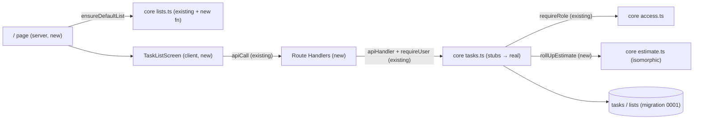
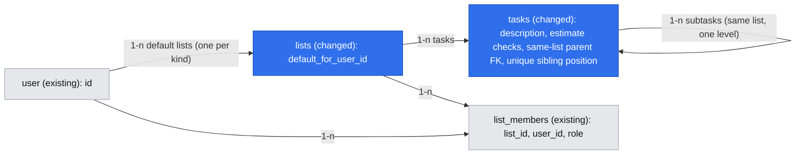

# Tasks and subtasks (E01)

- **Date:** 2026-10-16
- **Revised:** 2026-10-28, for the brief refresh of 2026-10-27 (R12–R18, D22–D24): subtask estimates add up into their task, an exact price is typed once, and quick add shows the amounts next to the title. Owner's answers to the revision's questions are under Open Questions.
- **Status:** draft
- **Issue:** #11 (stories #15, #16; task #22)
- **Depends on:** a separate spec for minimal sign-up / sign-in pages, built first (Q2; confirmed 2026-10-16): `.ai/specs/implemented/2026-10-16-sign-in-pages.md`, specifically its Phase A ("Phase 0" below); its Phase B (password reset) gates nothing here. Only PR B (steps 7–8: routes and the screen) waits for it; PR A (steps 1–6) does not.

## 📝 TLDR

The owner, mid-renovation, forgets low-impact tasks and loses each task's cost while choosing what to do next (brief, Problems). Today Taskly has no task feature: `packages/core/src/tasks.ts` is a stub that throws `NotImplementedError`, there are no task routes, and the app shows the Next.js starter page. This spec proposes (not yet built) that the signed-in owner gets one default task list. On it they add, edit and delete tasks with a title, an optional description and an optional typed PLN estimate, plus one level of subtasks with the same fields. A task with subtasks shows the sum of its subtasks' estimates instead of its own; its typed figure is kept and comes back when the last subtask is deleted (R12–R15). An exact price is typed once and shown as one amount (R18).

## ❓ Open Questions

None open. The revision of 2026-10-28 asked four; the owner answered them on 2026-10-28:

| Id | Question | Answer |
| --- | --- | --- |
| Q1 | Show a status message when the first subtask hides a typed estimate, and when deleting the last subtask brings it back? | Yes. Polite status messages, no dialog (UI/UX, "Roll-up messages"). |
| Q2 | Mark a summed estimate on the task row (e.g. "sum")? | No. The row looks the same; only the edit form says "Sum of subtasks". |
| Q3 | Update `.ai/docs/engineering-standards.md` §6, which still says subtask estimates are never summed (R06)? | Yes, together with this revision. The `summaryService.ts` TODO is replaced by E03-S02. |
| Q4 | Add R14 ("completing subtasks does not change the task's figure") as an acceptance criterion of E03-S01 (#20)? | Yes, with a note in `backlog.md`. |

## 📝 Problem Statement

- **Need (evidence):** the owner forgets many low-impact tasks (curtain rods, decorative wall, pantry finish) when choosing what to do next, and the cost of each candidate task "is lost in quick thinking and choosing". Source: `[INTERVIEW]` owner, 2026-10-15. This is the brief's main problem. D01 puts it first, and D13 narrows v1 to a prototype for the owner alone.
- **Why subtasks add up (2026-10-27):** in the test of discovery prototype revision 002, relayed by the owner, the future owner split jobs of unknown cost into subtasks instead of typing an amount and typed exact prices twice (once as min, once as max); the moved-in owner typed estimates only on subtasks and cared most about their sum. `[INTERVIEW]` `research/interviews/2026-10-27-prototype-test-person-{1,2}-via-owner.md`; decisions D22–D24.
- **Current code:**
  - Migration `0000` already has `tasks(title, parent_id, status, position, estimate_min_grosze, estimate_max_grosze, cost_grosze)`.
  - `parent_id` has no FK. There is no description column and no `min ≤ max` check.
  - Services are stubs. `createTaskInput` and `estimateSchema` exist.
  - `requireRole` and the lists service are implemented (#6).
  - No route or page uses any of this, and no sign-in page exists.
- **What this does not prove:** A01 (seeing costs changes ordering) and A02 (typing ranges by hand, per task or per subtask, is acceptable effort now that they add up) stay untested. This spec gives the owner the tool to test them.

## 📝 Proposed Solution

A vertical slice through the existing layers (`.ai/docs/engineering-standards.md`):

1. **db:** one additive migration. It adds `tasks.description`, a same-list self-FK for subtasks with cascade delete, estimate `CHECK`s, a unique sibling `position`, and a default-list marker on `lists`.
2. **core:** the task stubs become real services. Each one runs Zod-parse → `requireRole` on the task's list → work, in one transaction. `ensureDefaultList` gives each user exactly one default project list, which `deleteList` refuses to delete. `parsePlnToGrosze` converts typed amounts without floats. `rollUpEstimate` computes a task's estimate from its own typed figure and its subtasks; nothing summed is stored.
3. **app:** thin Route Handlers, plus one client screen at `/` built on TanStack Query with optimistic add/edit/delete.

Both answered questions shape this design:

- **One default list per user (Q1).** There is no list picker. The data stays list-scoped, so `requireRole`, the role matrix and a future multi-list or sharing version need no rework. Spaces (E02) become their own many-to-many entity instead of overloading `list_id`.
- **One level of subtasks (Q5).** A subtask is a `tasks` row whose `parent_id` points at a top-level task in the same list. `parent_id` cannot be changed after creation.

**The roll-up is computed, not stored (2026-10-28).** A task's `estimate_min_grosze` / `estimate_max_grosze` always hold the figure the owner typed on that task, or null. Adding subtasks never touches them, so the typed figure survives (R15). The estimate shown and counted is computed on read by `rollUpEstimate`: the typed figure when the task has no subtasks, the sum of the subtasks' figures otherwise.

**Alternatives rejected**

| Alternative | Why it lost |
| --- | --- |
| A separate `subtasks` table | Subtasks carry the same fields as tasks (D21), and a second table would duplicate every service and the later markers/spaces joins. |
| Tasks owned directly by a user, with no list | Bypasses the mandatory list-based authorization layer (`AGENTS.md`) and would need rework for sharing. |
| Picking the default list as "the first list the user owns" | Two first requests racing would create two lists. The unique marker is the backstop the standards require. |
| A stored sum column on the task, updated on every subtask write | Two sources of truth: every subtask create, edit and delete must update it in the same transaction, and a missed path or a race leaves a wrong figure that nothing detects. The computed sum is always consistent with the committed rows, and one owner's list is small (see `listTasks`). |
| Moving the typed figure to separate `own_estimate_*` columns | Adds a migration and a second pair of columns for no gain: the existing pair already is the typed figure, and the effective estimate is never stored. |

**Out of scope:** reorder UI and `moveTask` (E02-S01), markers (E02-S02), spaces (E02-S03), completion and the future-expenses total with its list of tasks without an estimate and its "Add estimate" form (E03), real cost, AI estimates, sharing and the shopping list (version 2).

## 📝 Research

The comparison set is the dated benchmark (`.ai/specs/research/2026-10-15_taskly_benchmark.md`) and general task-manager patterns (Todoist, Trello checklists). Those patterns come from product knowledge and were not re-checked on 2026-10-16 or 2026-10-28.

- **Worth copying:**
  - Quick capture where only the title is required, so a task is saved in one step and details come later. This matches the panel hypotheses H1 and H9 (`[SYNTHETIC]`) and R10 (estimate optional).
  - Deleting a parent removes its subtasks.
  - Subtasks shown inline under their parent.
  - Cost roll-up from parts. Renovation planners such as Buildry show planned cost per room built from its items; general task managers do not sum. We roll up one level only (R12).
- **Complexity we skip:**
  - Deep nesting. Mature tools allow several levels; we keep one (Q5).
  - Rich-text descriptions, attachments and comments.
  - A switch between "exact" and "range" (an extra click on every amount) and a single "400-600" text field (clashes with Polish number formatting). Both were rejected in D24.
- **Benchmark risk applied:** the benchmark flags "too much manual data entry" in mature tools. Hence estimate and description are optional, amount input accepts Polish formatting (`1 500,50`), and an exact price is typed once (R18).

## 📝 Architecture



All task access goes through `requireRole` on the task's list, and the only new client→server path is the existing `apiCall` helper. The roll-up rule lives in one isomorphic function that E03's future-expenses service reuses, so the task row and the total can never disagree.

- **Reused:**
  - `requireRole` / `can`
  - `apiHandler`, `requireUser`, `mapError` and the envelope
  - `apiCall` and `queryKeys.tasks(listId)`
  - `positionBetween`, `formatPlnRange` (changed) and `estimateSchema`
  - the error classes
- **New in core (isomorphic, `@taskly/core`):**
  - `parsePlnToGrosze`
  - `MAX_ESTIMATE_GROSZE`, `estimateGroszeSchema`, `estimateViewSchema`
  - `estimateFromAmounts` (the two form fields → an estimate, R18) and `rollUpEstimate` (R12–R14), in a new `estimate.ts`
  - `taskFieldsInput`, `createTaskInput` (changed), `updateTaskInput`
  - `subtaskViewSchema`, `taskViewSchema`, `taskListResponseSchema`, `deleteTaskResponseSchema`, and the inferred `TaskView` type
- **New in core (server, `@taskly/core/server`):**
  - `ensureDefaultList` in `lists.ts`, and a default-list guard in `deleteList`
  - `listTasks`, `createTask`, `updateTask` and `deleteTask` in `tasks.ts`
  - `moveTask` stays a stub for E02
- **New in app:**
  - routes `app/api/lists/[listId]/tasks/route.ts` and `app/api/tasks/[taskId]/route.ts`
  - components under `components/tasks/`
  - hooks `useTasks`, `useCreateTask`, `useUpdateTask`, `useDeleteTask`
  - shadcn primitives (Button, Input, Textarea, Label, AlertDialog) added to `packages/ui` with `npx shadcn@latest add`
- **Future work that depends on this:** E03-S02 (#21) computes future expenses over open main tasks by calling `rollUpEstimate` for each one (R17). It must not count subtasks separately and must not filter subtasks by `status` (R14).
- **Events:** services do **not** call `publishListEvent`. It is still a stub that throws, and live updates serve shared lists, which are out of scope for v1 (N02). This is a deliberate skip of step 4 of standards §3, the same as the lists service. The SSE spec adds the publish calls.
- **Caching:** the `/` page reads the session, so it renders dynamically inside `<Suspense>` (`cacheComponents` is on). The implementer reads `node_modules/next/dist/docs/` on Cache Components and `RouteContext` before writing the page and the routes.

## 📝 Data Model

Migration `0001` (generated by drizzle-kit, reviewed, committed) is additive only. It adds new nullable columns, constraints and indexes, and edits no applied migration.

| Change | Definition | Why |
| --- | --- | --- |
| `tasks.description` | `text NULL` | D14, D21. Length is limited by Zod (≤ 2000). |
| Same-list parent | unique index `tasks_list_id_id_idx (list_id, id)`, plus FK `(list_id, parent_id) → tasks(list_id, id) ON DELETE CASCADE` | The database guarantees a subtask's parent exists and is in the same list. Deleting a task deletes its subtasks (Q6). With `MATCH SIMPLE`, a top-level task (`parent_id NULL`) is not checked. |
| Estimate checks | `tasks_estimate_pair_chk`: `(estimate_min_grosze IS NULL) = (estimate_max_grosze IS NULL)`; `tasks_estimate_range_chk`: `estimate_min_grosze IS NULL OR (estimate_min_grosze >= 0 AND estimate_min_grosze <= estimate_max_grosze)` | Q7 and R01, enforced below Zod as well. An exact price is stored as min = max (R18), which both checks allow. |
| Unique sibling order | unique `tasks_sibling_position_uq (list_id, parent_id, position) NULLS NOT DISTINCT` (PostgreSQL 16 locally and in Testcontainers) | Two concurrent appends can never share a key. Duplicate keys would break `generateKeyBetween` in E02's reorder. |
| `lists.default_for_user_id` | `text NULL REFERENCES "user"(id) ON DELETE CASCADE`, partial unique index `lists_default_for_user_kind_uq (default_for_user_id, kind) WHERE default_for_user_id IS NOT NULL` | Exactly one default project list per user, safe under concurrent first requests. The same index can later back `ensureShoppingList` (kind `shopping`) without a new migration. |

- **Roll-up needs no schema change (2026-10-28).** On a top-level task, `estimate_min_grosze` / `estimate_max_grosze` are the figure the owner typed on it. They are written only by an explicit estimate edit of that task, never by a subtask write, so a typed figure hidden by subtasks is kept as it was (R15). The effective estimate is computed on read and never stored.
- **Unchanged and unused here:** `tasks.status` (E03), `tasks.cost_grosze` (version 2, D17) and the existing `tasks_list_parent_idx`. Columns are not dropped (expand-only, per `BACKWARD_COMPATIBILITY.md`).
- **Position** stays `text` with the default collation. Every ordering query uses `position COLLATE "C"` (standards §6), so the column collation does not change.
- **Sensitive data:** titles and descriptions are free text about the owner's house. They are scoped by list membership. Request bodies are not logged. `apiHandler` logs only unexpected (500) errors, and constraint violations, whose pg `detail` holds the row values, are translated to 404/409 before reaching it (see API Contracts).



## 📝 API Contracts

### Shared schemas and functions (`@taskly/core`, isomorphic)

```ts
MAX_ESTIMATE_GROSZE = 1_000_000_000          // 10 000 000.00 PLN; fits integer
groszeSchema: int, ≥ 0                        // unchanged and uncapped: sums and E03 totals may exceed the estimate cap
estimateGroszeSchema: int, 0 … MAX_ESTIMATE_GROSZE
estimateSchema: { minGrosze, maxGrosze } (both estimateGroszeSchema), refine min ≤ max with path ["maxGrosze"]
                                              // input: what the owner types
estimateViewSchema: { minGrosze, maxGrosze } (both groszeSchema), refine min ≤ max
                                              // output: a summed estimate may exceed the input cap

taskFields = {                                // NO defaults anywhere in this object
  title: string, trimmed, 1–200
  description: string, trimmed, ≤ 2000; "" → null; nullable
  estimate: estimateSchema | null
}
createTaskInput = { title, description: default null, estimate: default null }   // listId is the route param
                  // Phase 2 adds: parentId: uuid | null = null (additive)
updateTaskInput = taskFields.partial(), refine: at least one key
                  // built from taskFields, never from createTaskInput: Zod 4's .partial() keeps
                  // defaults, so { title } would parse to { title, description: null, estimate: null }
                  // and wipe both fields

subtaskViewSchema = z.object({
  id: z.uuid(),
  title: string, 1–200,
  description: string, ≤ 2000, nullable,
  estimate: estimateViewSchema.nullable()     // a subtask's typed figure
})
taskViewSchema = subtaskViewSchema.extend({
  // estimate: the effective estimate, from rollUpEstimate
  unestimatedSubtasks: int, ≥ 0,              // R13; 0 for a task without subtasks
  subtasks: z.array(subtaskViewSchema)
})
taskListResponseSchema = z.array(taskViewSchema)
deleteTaskResponseSchema = taskViewSchema.nullable()
type TaskView = z.infer<typeof taskViewSchema>
// Response fields have no defaults: missing fields must fail validation.
// Accept additive unknown fields, preserving compatibility with newer servers.

parsePlnToGrosze(text: string): number | null
// accepts "1500", "1500.5", "1 500,50" (space / NBSP thousands, comma or dot decimal, ≤ 2 decimals);
// pure string arithmetic, no floats; null for anything else

estimateFromAmounts(amount: string, upTo: string)
  : { ok: true; estimate: Estimate | null } | { ok: false; fieldErrors: { amount?: string; upTo?: string } }
// R18. Both empty → null. One filled (either field) → { min = max = that amount }.
// Both filled → { min: amount, max: upTo }. Parses with parsePlnToGrosze and validates with estimateSchema;
// errors go on the field that holds the bad text; amount > upTo → error on upTo.

rollUpEstimate(own: Estimate | null, subtasks: readonly (Estimate | null)[])
  : { estimate: Estimate | null; unestimatedSubtasks: number }
// R12–R14. No subtasks → { estimate: own, unestimatedSubtasks: 0 }.
// Otherwise own is ignored (kept in the row, R15): estimate = sum of the minimums and sum of the maximums
// of the subtasks that have one, or null when none has; unestimatedSubtasks = subtasks without one.
// Takes no status: completed subtasks count (R14). Integer arithmetic only.
```

The `estimateSchema` refine path moves to `maxGrosze`. `mapError` then reports field errors under `estimate.maxGrosze`, and the form shows the message next to the "up to" field. `aiEstimateResponse` reuses the same schema, which is harmless (it carries no field UI).

The response schemas validate outputs at runtime, not just through TypeScript. POST and PATCH return the `taskViewSchema` of the **top-level task that holds the affected row**: the task itself, or, for a subtask, its parent with all its subtasks and the new effective estimate. DELETE returns the parent's `TaskView` when a subtask was deleted and `null` when a top-level task was. GET returns `taskListResponseSchema`. A subtask change can change its parent's figure, so the client always receives the parent as the server computed it and never sums anything itself (standards §6). Infer client types from these schemas rather than defining a separate response shape. The typed figure of a task with subtasks is not returned: the UI never shows it (R15), and adding it later is an additive change.

### Services (`@taskly/core/server`)

Every service runs in `db.transaction`. "Write" means `requireRole(tx, userId, listId, "write")`.

| Function | Authorization | Behaviour |
| --- | --- | --- |
| `ensureDefaultList(db, userId)` → `string` | the session user | Read first: a plain `SELECT` of the user's default project list returns its id, so the normal case writes nothing. Only on a miss, in one transaction: `INSERT … ON CONFLICT (default_for_user_id, kind) WHERE default_for_user_id IS NOT NULL DO NOTHING RETURNING id`, then an `owner` `list_members` row only when a row was returned; otherwise select the existing id again. Name: "My renovation". Idempotent. |
| `deleteList(db, userId, listId)` (existing, **changed**) | `manage` | Besides the lock change below, it rejects a list with `default_for_user_id IS NOT NULL` with `ConflictError("The default list cannot be deleted")`, like the shopping list. `renameList` still allows renaming it. |
| `listTasks(db, userId, listId)` → `TaskView[]` | `read` | Top-level tasks by `position COLLATE "C"`, then `id`, each with its subtasks in the same order and its estimate from `rollUpEstimate`. One query, grouped in memory. Not paginated, because one owner's renovation list is expected to stay in the low hundreds (Q02 open); revisit when E02 adds filters. |
| `createTask(db, userId, listId, input)` → `TaskView` | `write` on `listId` | After authorization, lock the `lists` row `FOR NO KEY UPDATE` to serialize appends. Phase 2, when `parentId` is set: then read the parent `FOR KEY SHARE`; it must be in `listId` and top-level, otherwise `NotFoundError("Task")` or `ConflictError("Subtasks cannot have subtasks")`. The parent lock makes a concurrent parent delete wait for this transaction, then cascade. Set position = `positionBetween(last sibling, null)`: new tasks and subtasks always append at the end of their siblings. The parent's typed estimate is not touched (R15). Returns the new task, or the parent's `TaskView` for a subtask. |
| `updateTask(db, userId, taskId, input)` → `TaskView` | `write` on the task's list | Via `requireTaskRole`. Writes only the keys present in the parsed input. `parentId` is not updatable. When the input has an `estimate` key and the task is top-level with at least one subtask (checked after the task row is locked): `ConflictError("A task with subtasks takes its estimate from them")`. Returns the task, or the parent's `TaskView` for a subtask. |
| `deleteTask(db, userId, taskId)` → `TaskView \| null` | `write` on the task's list | Via `requireTaskRole`. Subtasks go with it through the FK cascade. Returns the parent's `TaskView` (after the delete) for a subtask, `null` for a top-level task. When the last subtask goes, the parent's typed figure, if any, is its estimate again (R15) with no write to the parent. |

**`requireTaskRole(tx, userId, taskId, action)`**

- **Lock order matches `deleteList`, membership before task:**
  1. Read the task's `list_id` without a lock. This is safe because `list_id` is immutable.
  2. Run `requireRole` on that list. `manage` takes the membership row `FOR UPDATE`; any other action takes it `FOR SHARE`.
  3. Re-select the task `FOR UPDATE`.
- **Rejections:**
  - An unknown or malformed id, a task in a list the user does not belong to, or a task deleted between steps 1 and 3 → `NotFoundError("Task")`.
  - A viewer → `ForbiddenError`.

**Lock protocol (all list-scoped writes)**

| Who | Lock order |
| --- | --- |
| Writers (task create, update, delete) | 1. Their **own** membership row `FOR SHARE` (`requireRole`). 2. For appends, the `lists` row `FOR NO KEY UPDATE`. 3. Then task rows (the parent `FOR KEY SHARE` on subtask creation; the target `FOR UPDATE` on update/delete). Inserts also take an implicit `FOR KEY SHARE` on `lists` through the FK, compatible with their already-held append lock. |
| List deletion (`deleteList`, existing code, **changed by this spec**) | 1. Its own membership `FOR UPDATE` (`requireRole … "manage"`). 2. Then **all** membership rows of the list `FOR UPDATE`, ordered by `user_id`. 3. Only then the `DELETE FROM lists`. |

Why `deleteList` must change: per-actor membership locks do not serialize *different* users. Today `deleteList` locks only the owner's own row, then locks the list row and cascades into the editor's membership row. Meanwhile an editor's insert holds the editor's membership row and waits on the list row. That is a cycle. A parallel review reproduced it as `40P01` against local PostgreSQL (lesson `2026-10-16-cross-actor-list-locks`). With the change, deletion waits until every in-flight writer of the list has committed.

**Roll-up under concurrency.** The sum is read from committed rows, so there is no counter that two writers could leave wrong. Task transactions run at PostgreSQL's default READ COMMITTED level.

- **Estimate edit vs. the first subtask:** the estimate edit holds the task `FOR UPDATE`, which conflicts with the subtask insert's `FOR KEY SHARE` on the same row (both the explicit lock and the FK check's implicit one), so the two run one after the other. If the edit commits first, its figure is saved and then hidden by the new subtask (R15). If the insert commits first, the edit sees the subtask and gets the 409. This depends on two things the implementation must keep: the subtask-existence query is a separate statement run after the `FOR UPDATE` is granted (under REPEATABLE READ, or with the check before the lock, the edit would save silently), and `requireTaskRole` keeps `FOR UPDATE` (`FOR NO KEY UPDATE` does not conflict with `FOR KEY SHARE`).
- **Adding one subtask while deleting another:** the two lock different rows and both commit. Each response is computed inside its own transaction and may miss the other's row. The client's `onSettled` invalidation refetches the list, which is then consistent. The kept figure comes back only if no subtask is left after both have committed.

**DB constraint errors are translated in `tasks.ts`, never surfaced raw**

| PostgreSQL error | Becomes |
| --- | --- |
| `23503` (FK) | `NotFoundError("Task")` |
| `23505` (unique) | `ConflictError("Please try again")` |
| `23514` (check) | `ConflictError("Invalid estimate")` |

So these failures map to 404 or 409, and pg's "Failing row contains (…)" detail never reaches `apiHandler`'s 500 log.

### HTTP (`apiHandler` envelope; `requireUser` first)

| Route | Body | Success `data` | Errors |
| --- | --- | --- | --- |
| `GET /api/lists/[listId]/tasks` | — | `TaskView[]` | 401, 404 |
| `POST /api/lists/[listId]/tasks` | `createTaskInput` | `TaskView` (the task, or the subtask's parent) | 400 (`fieldErrors`), 401, 403, 404, 409 (depth; "Please try again"; "Invalid estimate") |
| `PATCH /api/tasks/[taskId]` | `updateTaskInput` | `TaskView` (the task, or the subtask's parent) | 400, 401, 403, 404, 409 (estimate of a task with subtasks; "Invalid estimate") |
| `DELETE /api/tasks/[taskId]` | — | `TaskView` (a subtask's parent) or `null` | 401, 403, 404 |

All of these are new routes, so no existing contract changes. Once shipped, they are protected by `BACKWARD_COMPATIBILITY.md`, which allows only additive changes. The `listId` route param is passed to the service separately. The body is never spread into an insert.

**Response validation boundaries**

- Extend the existing `apiHandler` with an optional response schema; every task route supplies its schema from the table above. Validate success `data` before serializing the envelope. Invalid service output is a generic 500, never a 400 input error. Do not pass the output `ZodError`, its values, or its details to the logger or client; log only a fixed diagnostic for the output-contract failure. Keep existing callers without a response schema working.
- Extend the existing `apiCall` to accept a response schema; all task hooks supply it. Validate the success envelope and its `data` before returning or putting anything in the Query cache. A malformed response throws `ApiError` with code `bad_response`, entering the existing error/optimistic-rollback path. Validate error-envelope fields defensively as well. Keep all HTTP calls in this helper.
- Unit tests cover valid task/subtask/list/null responses, missing required fields (including `unestimatedSubtasks`), incorrect field types, invalid estimate ranges, a summed estimate above `MAX_ESTIMATE_GROSZE` (valid), malformed envelopes, and additive unknown fields. Route tests prove invalid output becomes a generic 500 without exposing row values; client tests prove malformed data is rejected before it reaches the cache.

## 📝 UI/UX

There is one screen, at `/`, for a signed-in user. A signed-out user is redirected to the sign-in page from the auth spec. The layout is mobile-first, with touch targets of at least 44 px below 640 px and 36 px from 640 px (design-system decision V1, 2026-10-26).

- **Amount fields (R18, D24).** Every estimate is two fields in a group labelled "Estimate (optional)": "Amount" and "up to (optional)", each with `inputmode="decimal"` and the suffix "zł". One filled field (either one) is an exact price, saved as min = max. Both filled is a range. Both empty is no estimate. The form turns them into an estimate with `estimateFromAmounts`.
- **Quick add (discovery prototype C1; owner, 2026-10-27).** At the top, in one row: Title, Amount, "up to (optional)" and "Add". Below 640 px the amount fields wrap under the title. Enter in any field submits. Only the title is required. The description sits behind a "Description" toggle under the row (the design system's collapsible text action with its arrow, `aria-expanded`; owner, 2026-10-28, replacing the prototype's "+ Description"). After an add the toggle collapses and the field is cleared. There is no "Details" disclosure.
- **After an add.** The new task is appended at the end of the list. Its row scrolls into view and is briefly highlighted (no scroll animation or highlight under `prefers-reduced-motion: reduce`), and focus stays in the quick-add title field for the next capture. A new subtask is appended at the end of its parent's subtasks.
- **Task row.**
  - The row shows the title, the estimate as `formatPlnRange` (or "No estimate" in muted text) and, for a task with subtasks, "N subtasks" on a second line. Opening the row (its title) shows the description and the indented subtasks, each with its own estimate, plus "Add subtask". The description is shown only in the opened row (design system `TaskRow`; owner, 2026-10-26, prototype map L07).
  - **Summed estimate (R12, R13).** For a task with subtasks, the row's estimate is the sum from the server (`TaskView.estimate`), shown exactly like a typed one, with no extra mark (Q2). When `unestimatedSubtasks` is above 0, the second line adds "1 subtask without an estimate" / "N subtasks without an estimate" in muted text. When no subtask has an estimate, the row shows "No estimate" together with that count.
  - **Note (2026-10-22, design system decision F11, approved by the owner):** `formatPlnRange` in `packages/core/src/money.ts` currently returns "1200,00 zł – 1500,00 zł" (`pl-PL` groups thousands only from five digits, always two decimals, spaces around the dash). Tokens rule 5 and the design system (`EstimateRange`) require "1 200–1 500 zł": thousands grouped with a non-breaking space, grosze only when not zero, an en dash without spaces, one "zł". Fix `formatPlnRange` (with unit tests) as part of this spec's UI work (PR B). **Since 2026-10-28 (R18):** when min = max it returns one amount ("500 zł", "12,50 zł"). This also applies to a summed estimate whose sums are equal.
  - Row actions are in the row's "…" menu: "Add subtask", "Edit" and "Delete" (L07).
  - A subtask row has the same fields and actions except "Add subtask".
- **Add subtask.** The form uses the quick-add layout (Title, Amount, "up to (optional)", Add; the "Description" toggle), labelled "New subtask". It has no note about where the money goes: the parent's figure changes as soon as the subtask is saved.
- **Edit:** the row switches in place to the same fields, in the same order (title, amounts, description), prefilled. The description field is open when the task has a description. An exact price is prefilled in "Amount" with "up to" empty; a range fills both. Clearing both amounts removes the estimate. The form sends only the fields the owner changed.
  - **A task with subtasks (R12).** The amount fields are not shown. In their place is read-only text, "Sum of subtasks: 1 200–1 500 zł" (or "Sum of subtasks: no estimate yet"), followed by "Change the amounts on the subtasks." Hidden rather than disabled: a disabled field looks editable and is skipped by screen readers.
  - **409 on an edit save** (the task got a subtask in another tab): the form shows the server's message, "A task with subtasks takes its estimate from them", keeps the typed text and refetches the list; the amount fields then give way to the read-only sum. The whole PATCH was refused, so other changed fields (e.g. the title) are not saved yet; saving again sends them without the estimate.
  - **Materials and other extra costs (R12)** are an ordinary subtask; the UI adds no separate field or hint for them.
- **Roll-up messages (Q1; owner, 2026-10-28).** A polite status message (`role="status"`, no dialog, no toast), shown after the server confirms as a muted line in the parent task's row until its next change (owner, 2026-10-28):
  - **first subtask:** the parent, as cached before the optimistic insert (the `onMutate` snapshot), had no subtasks and a non-null estimate, and the server's parent has subtasks: "The estimate of “{title}” is now the sum of its subtasks. Your amount is kept and comes back if you delete all subtasks.";
  - **last subtask:** the server's parent returned by DELETE has no subtasks and a non-null estimate: "The estimate of “{title}” is back to your amount: {amount}.". When the task never had its own figure there is no message; the row simply shows "No estimate".
  - Both are decided from the mutation's own response. In the two-tab race of Edge Cases (a subtask added elsewhere while the last one is deleted) the refetch can then contradict the message; this is accepted for a single-user v1.
- **Task deleted elsewhere (404 on an edit save or on adding a subtask):** the form shows "This task was deleted. The list has been refreshed.", the list is refetched and the row disappears; focus moves to the list. The server answers 404 both for a deleted task and for one the user cannot access, so the message must not claim more than that (owner, 2026-10-27, prototype map L15, states s06.8 and s07.6).
- **Delete:** a confirm dialog. For a task with subtasks it reads "Delete '{title}' and its N subtasks?". Deletion is irreversible (there is no soft delete).
- **Validation:**
  - The form turns the amounts into an estimate with `estimateFromAmounts` and validates with the same `createTaskInput` / `updateTaskInput` before sending.
  - Server `fieldErrors` are shown under the matching field: `title`, `description`, `estimate.minGrosze` under "Amount", `estimate.maxGrosze` under "up to". When only one amount field was filled, both map onto that field.
  - Messages: "Enter an amount like 1 500,50" and "“Up to” must not be less than the amount.". The former rule "Enter both amounts or neither" is gone (D24; supersedes screen map L03 and the old AC6 of #15).
- **States:**
  - **Loading:** a skeleton.
  - **Empty:** "No tasks yet. Start with one task. Only the title is required." with focus in the title field (owner, 2026-10-26, prototype map L22).
  - **Error:** a message with "Try again" (refetch).
  - **Page did not open** (the server page fails before any list exists, e.g. `ensureDefaultList` errors): the app shell stays, with a working "Sign out" and theme toggle, the heading "My renovation", and an error state "Could not open your tasks." with "Try again". There is no quick add and no list (owner, 2026-10-27, prototype map L13 and DS04, state s04.21).
  - Shared loading, empty and error components go in `packages/ui/src/components/` (standards §5).
- **Optimistic updates:**
  - Only add is optimistic: it inserts a temporary row at the end. Edit and delete wait for the server: the edit form shows "Saving…" and the row changes only after the server confirms; the delete dialog shows "Deleting…" and the row goes after the server confirms (design system "Optimistic change"; owner, 2026-10-26, prototype map L08).
  - A temporary row is pending until the server returns its real id: it renders dimmed, and its Edit, Delete and Add subtask actions are disabled, so no request is ever sent with a temporary id.
  - A temporary subtask does not change its parent's figure. The parent's estimate and count change when the server's parent `TaskView` replaces the cached one.
  - On error the cache rolls back and a toast-free inline error is shown; typed text is kept (design system texts, L14):
    - add refused: the temporary row goes and "Could not add the task. Try again." appears above the form;
    - add refused with 409: the form shows the server's `error.message` instead (e.g. "Please try again"). `ConflictError` messages are fixed, user-facing texts with no row data, so this is safe to show (owner, 2026-10-27, state s04.12);
    - edit refused: the form stays open with "Could not save the task. Try again.";
    - delete refused: the dialog stays open with "Could not delete the task. Try again.".
  - `onSettled` invalidates `queryKeys.tasks(listId)`.
- **Accessibility:**
  - Labelled inputs, with errors linked through `aria-describedby`. The two amount fields sit in a `role="group"` named by its visible label.
  - Subtasks are a nested list (`<ul>` inside an `<li>`).
  - The dialog traps focus and returns focus to the trigger.

Prototypes: `.ai/prototypes/discovery/task-list-v1/revision-002/` (discovery; C1 adopted, C2/C3 dropped by the roll-up, C4/C5 belong to E03-S02) and `prototypes/task-list-v1/` (styled; to be brought in line with this revision).

## 📝 Edge Cases & Failure Scenarios

| Case | Outcome the user sees |
| --- | --- |
| Amount greater than "up to" | The form blocks the save with "“Up to” must not be less than the amount." under "up to". If bypassed, the API returns 400 with `fieldErrors`, and the DB `CHECK` is the last line. |
| Only one amount typed, in either field | Saved as an exact price (min = max) and shown as one amount, e.g. "500 zł" (R18). |
| Both amounts typed and equal | Saved as min = max and shown as one amount. |
| `12,5`, `12.50`, `1 500`, `-5`, `1e3`, `12.345` | The first three are accepted (1250, 1250, 150000 grosze). The rest get "Enter an amount like 1 500,50" under the field that holds them. |
| Amount over 10 000 000 PLN | Field error. |
| First subtask added to a task with a typed estimate | The task's figure becomes the subtask's (or "No estimate" plus "1 subtask without an estimate" if the subtask has none). The typed figure is kept in the database, and the status message says so (Q1). |
| Last subtask deleted | The kept typed figure is the task's estimate again, with the status message. A task that never had one shows "No estimate" (R15). |
| Every subtask is without an estimate | The task shows "No estimate" and "N subtasks without an estimate" (R13). E03 leaves it out of future expenses and lists it among the tasks without an estimate (R10). |
| A subtask is completed (E03) | The task's figure does not change (R14): `rollUpEstimate` takes no status. |
| Owner edits a task that has subtasks | No amount fields; the read-only sum and "Change the amounts on the subtasks." are shown. A crafted PATCH with `estimate` gets 409. |
| Estimate edit races the first subtask (two tabs) | The parent row lock serializes them: either the edit's figure is saved and then hidden by the subtask, or the edit gets 409 and the form shows the server's message and refetches (see Roll-up under concurrency). |
| A subtask added in one tab while another is deleted in a second tab | Both succeed. Each response may miss the other change; the refetch after settling shows the sum of the subtasks that remain. If the deleted one looked like the last, its tab may briefly announce "back to your amount" before the refetch shows the new subtask's figure (accepted, see Roll-up messages). |
| Estimate and title changed together while the task got a subtask in another tab | 409; nothing is saved. The form keeps the typed title, the amounts give way to the read-only sum, and saving again saves the title. |
| Sum of subtasks above 10 000 000 zł | Shown as it is. The cap applies to typed amounts only; the response schema uses the uncapped `groszeSchema`. |
| Subtask added under a subtask (crafted request) | 409 "Subtasks cannot have subtasks". The UI never offers it. |
| Parent in another list (crafted request) | 404, and the composite FK also rejects it. |
| Parent deleted while a subtask is being added (two tabs) | If the add locks the parent first, the delete waits and then cascades the new subtask. If the delete commits first, the add gets 404: the form shows "This task was deleted. The list has been refreshed." and the refetch shows the consistent state (see UI/UX). |
| Task deleted in another tab while it is being edited | The save gets 404 and the UI behaves as in the previous row. |
| Two quick adds racing | The `lists` row lock serializes them, so they get distinct positions. If the unique sibling index ever fires, the result is 409 "Please try again", not a 500. The quick-add form shows that server message and keeps the typed text. |
| Editor adds a task while the owner deletes its list (API only; no editors exist in v1) | The delete locks every membership before touching the list (see Lock protocol). If the editor already holds their membership lock, deletion waits for the add to commit and then cascades it. If deletion wins first, the add gets 404. Neither ordering produces `40P01` or a 500. |
| First visit races in two tabs | `ensureDefaultList` returns the same list (unique index plus `ON CONFLICT`). |
| Task id of another user's list, or a malformed id | 404, which does not reveal whether it exists. |
| Session expired mid-use | 401. The client redirects to sign-in, and the unsaved form text is lost (accepted for v1). |
| Server produces an invalid task response | Server output validation returns a generic 500. If malformed data nevertheless reaches the browser, the client rejects it with `bad_response`, shows the existing error state, and rolls back an optimistic action. Invalid data never enters the Query cache. |
| Network failure on an optimistic action | Rollback plus an inline error. Nothing is half-saved, because each call is one transaction. |
| Owner tries to delete the default list (no UI for it; API exists from #6) | 409 "The default list cannot be deleted". Its tasks stay. Renaming it is allowed. |
| User acts on a just-added row before the server confirms it | Its actions are disabled until the real id arrives; nothing is sent with a temporary id. |

## 📝 Risks & Impact Review

- **`risk-high`** (schema migration, money, data scoping), per `SDLC.md`. The implementation PRs must carry:
  - a migration test applying `0001` on a clean DB and on a DB with `0000` data. The upgrade test needs a fresh database, which the local dev role cannot create (no `CREATEDB`, and the migrations hard-code `"public"`), so it runs under Testcontainers in CI and skips itself when `TEST_DATABASE_URL` is set. The rollback SQL is tested by hand and recorded in the run log;
  - money parsing, exact-price and roll-up boundary tests;
  - an isolation integration test showing user B cannot list, add to, edit or delete user A's tasks, and that B's default list is separate;
  - `needs-qa` with no self-QA, and a second reviewer. PR A has no routes or UI, so its QA is evidence-based: the PR body carries the pre-deploy violation query and its output on the dev DB, `0001` applied to the dev DB, the integration run (isolation, concurrency, deadlock tests), the CI migration-upgrade test and the manual rollback check, and the QA reviewer verifies that evidence. PR B and PR C get hands-on QA.
- **Constraint tightening on existing data:** adding the `CHECK`s and the unique sibling index fails if a database already holds violating rows. No feature writes tasks today, but a pre-deploy query (`SELECT … WHERE` violates) goes in the PR body. If it finds rows, fix the data first.
- **Rollback plan** (no down migration is generated): drop the new constraints and indexes, then `tasks.description` and `lists.default_for_user_id`. Dropping the columns loses descriptions and the default-list marker, but not tasks. The app's previous build ignores the new columns. The roll-up adds nothing to roll back in the database.
- **Hard to reverse later:**
  - The `TaskView` and route shapes become a protected HTTP surface. `TaskView.estimate` means the effective estimate; exposing the kept typed figure later is additive.
  - Subtask mutations return the parent `TaskView`; going back to returning the subtask would be a breaking change.
  - "One level of subtasks" is a cheap rule to relax later (drop the 409 check), but a costly one to tighten once deeper data exists. Deeper nesting would also need a recursive roll-up.
- **Stub signature change:** `createTask(db, userId, input)` becomes `(db, userId, listId, input)` to match `renameList`. It has no consumers yet.
- **Totals rule (updated 2026-10-28, Q3):** `.ai/docs/engineering-standards.md` §6 now says totals count main tasks only, each with its effective estimate from `rollUpEstimate`, so subtasks are never counted a second time (R12, R17). It replaces the 2026-10-16 wording ("subtask estimates are informational and never summed", R06). The TODO in `packages/core/src/summaryService.ts` still says "leaf tasks"; E03-S02 replaces it when the summary is built.
- **Issue #22 scope (resolved 2026-10-16):** the owner approved narrowing #22 to this spec's migration. Completed state, markers and spaces ship with their own migrations in E02/E03.

## 📝 Decisions in play

- **Relied on:**
  - D02, D13 (single owner, simple prototype)
  - D14 (description)
  - D22, R12–R15 (subtasks with their own estimate, summed into the task; the typed figure kept)
  - D23, R16 (typed min–max on a subtask or on a task without subtasks; no real cost)
  - D24, R18 (an exact price typed once, shown as one amount)
  - R01 (PLN, integer grosze)
  - R10 (estimate optional)
  - N02 (no sharing UI)
- **Partly delivered:**
  - D21. Subtasks get a description and an estimate here; markers and spaces arrive with E02 for tasks and subtasks together.
  - R14, R17. This spec delivers the per-task effective estimate and `rollUpEstimate`, which ignores completion; the future-expenses total and completion are E03.
- **No longer relied on (superseded in the brief on 2026-10-27):** D15, D16, R06, R07, R08. This spec proposes no new superseding.
- **Grilling decisions (owner, 2026-10-16):**
  - The default list cannot be deleted; it can be renamed.
  - The 10M PLN cap applies to estimate inputs only (`estimateGroszeSchema`); `groszeSchema` stays uncapped for totals and, since 2026-10-28, for summed estimates.
  - The upgrade migration test runs only in CI (Testcontainers); the rollback is checked by hand.
  - Delivery is three PRs (see Phasing); PR A gets evidence-based QA.
  - New tasks append at the end, scroll into view and keep focus in quick-add.
  - Pending optimistic rows have their actions disabled.
  - `ensureDefaultList` reads first and writes only on a miss.
- **Clickable prototype decisions (owner, 2026-10-26 and 2026-10-27; `prototypes/konta-i-role/mapa-ekranow.md`, `prototypes/task-list-v1/`):** the description is shown only in the opened row and actions sit in "…" (L07); only add is optimistic (L08); the "page did not open" state (L13); design-system error texts (L14); the deleted-task message (L15); the empty-state text (L22); a 409 on add shows the server's message. L03 ("both amounts or neither") is superseded by D24. All of these are in UI/UX above.
- **Discovery prototype revision 002 (owner, 2026-10-27):** C1 (amounts next to the title in quick add, description behind a toggle) is adopted. C2 and C3 (the "For reference only" note) no longer apply after D22. C4 and C5 (the named list of tasks without an estimate and the row's "Add estimate") belong to E03-S02.
- **Revision questions (owner, 2026-10-28):** Q1–Q4 in Open Questions.

## 📋 Phasing

- **Phase 0 (prerequisite, separate spec):** minimal sign-up / sign-in pages and a session redirect (Phase A of the sign-in spec).
- **Phase 1 — Tasks (#15, #22):** migration, money parsing, exact price, default list, task services, routes and the screen. Shippable alone: the owner can capture tasks with estimates.
- **Phase 2 — Subtasks and the roll-up (#16):** one level of subtasks in the services and the UI, and the task's estimate summed from them. It builds on the Phase 1 schema, which already contains the parent FK.

**Delivery: three PRs.** Each one mentions the PRs it depends on without closing their issues. Epic #11 closes during post-merge housekeeping once all three are merged.

| PR | Steps | Closes | Waits for | QA |
| --- | --- | --- | --- | --- |
| A — schema and core | 1–6 | #22 | nothing | Evidence-based (see Risks) |
| B — routes and screen | 7–8 | #15 | Phase 0 merged (step 7's HTTP tests need its `createUser` helper and session config) | Hands-on |
| C — subtasks and roll-up | 9–11 | #16 | PR B | Hands-on |

PR A is db and core only. Its integration tests insert users directly, like the existing `lists` and `access` tests. The routes become protected HTTP surface only when PR B ships them together with the UI that uses them.

**Precondition for PR B and PR C:** issues #15 and #16 carry the acceptance criteria below (rewritten on 2026-10-28 from R12–R18), and #20 carries R14. The tests in steps 8–10 refer to these numbers.

- **#15:** AC1 title, description, Amount 1 500 and up to 2 000 → "1 500–2 000 zł". AC2 12,50 → 1250 grosze, "12,50 zł". AC3 no amounts → saved without an estimate. AC4 Amount greater than "up to" → refused with a message on "up to". AC5 a list the owner does not belong to → not found. AC6 only one amount (either field) → stored as min = max and shown as one amount, "500 zł" (R18; replaces "both amounts or neither"). AC7 quick add shows Title, Amount and "up to" without opening anything; the description is behind a "Description" toggle (C1).
- **#16:** AC1 a subtask with a description and an estimate appears under its task (D22, D21). AC2 a task with its own 1 000–2 000 gets subtasks 300–400 and 500 → the task shows 800–900 zł; deleting both brings back 1 000–2 000 zł (R12, R15). AC3 one subtask without an estimate → left out of the sum and counted as "1 subtask without an estimate"; all without → "No estimate" (R13). AC4 editing a subtask's estimate changes the task's figure, and the task's edit form offers no amount fields (R12). AC5 a subtask on a task the owner cannot access → not found.
- **#20 (E03-S01):** completing subtasks does not change the task's estimate (R14).

## 📋 Implementation Plan

Each step ends with `npm test` at 100% coverage and leaves the app working.

### Phase 1 — Tasks

1. **Migration `0001`.** Update `packages/db/src/schema.ts` (description, composite parent FK, unique `(list_id, id)`, estimate checks, unique sibling position with `nullsNotDistinct`, `lists.default_for_user_id` and its partial unique index). Run `npm run db:generate` and review the SQL. Declare `(list_id, id)` as a `unique()` constraint and check that it comes **before** the composite FK in the generated file. drizzle-kit writes FKs before indexes (see `0000`), and the FK needs the unique to exist. Reorder by hand before the migration is first applied if needed. Extend `schema.integration.test.ts`: the checks reject min > max, one bound and a negative amount, and accept min = max; a cross-list parent is rejected; deleting a parent cascades; duplicate sibling positions are rejected; a second default project list for the same user is rejected. Add an upgrade test that runs only under Testcontainers and skips itself when `TEST_DATABASE_URL` is set: on a fresh database, apply `0000`, insert lists, members and tasks (top-level, `parent_id` set, with and without estimates), apply `0001`, and assert the rows survive and the new constraints hold. Write the rollback SQL into the run log and test it once by hand.
2. **Money, estimates and schemas.** Add `parsePlnToGrosze` and `MAX_ESTIMATE_GROSZE` to `money.ts`. Add `estimate.ts` with `estimateFromAmounts` and `rollUpEstimate`. Add `estimateGroszeSchema` (leaving `groszeSchema` uncapped), `estimateViewSchema`, `taskFields` / `createTaskInput` (without `parentId`) / `updateTaskInput`, the `estimateSchema` path, the four response schemas (with `unestimatedSubtasks`; delete as a nullable `TaskView`) and the inferred `TaskView` type to `schemas.ts`. Unit tests:
   - every amount row of Edge Cases, plus the boundaries (0, max, max + 1), and that `groszeSchema` still accepts values above the cap;
   - `estimateFromAmounts`: both empty → null; only "Amount" → min = max; only "up to" → min = max; both → range; equal → min = max; amount > "up to" → error on `upTo`; a bad text in either field → error on that field;
   - `rollUpEstimate`: no subtasks with and without its own figure; subtasks with estimates (own figure ignored); a mix with some unestimated (count); all unestimated → null; equal sums; a sum above `MAX_ESTIMATE_GROSZE`;
   - a regression test that `updateTaskInput.parse({ title: "x" })` yields exactly `{ title: "x" }`, and that `{}` is rejected;
   - valid and malformed output shapes, including missing fields, invalid estimate ranges, empty subtask arrays, a summed estimate above the cap and compatible additive fields.
3. **`ensureDefaultList`** in `lists.ts`, read first and writing only on a miss. Unit tests use a mocked `Db` and cover both the hit path (no insert) and the miss path. Integration tests: idempotent, two concurrent first calls → one list and one owner row, separate per user.
4. **`deleteList` changes:** the default-list guard (`ConflictError("The default list cannot be deleted")`; unit and integration tests, plus a test that `renameList` still renames it), and the lock change (Lock protocol): lock all of the list's membership rows `FOR UPDATE`, ordered by `user_id`, before the delete. The concurrency tests use a non-default project list made with `createList`. Integration test with **distinct actors** and explicit barriers: an editor's open write transaction plus the owner's `deleteList` → no `40P01`, the delete completes after the editor commits, and nothing is left behind. Exercise the complete `createTask` service in step 5 and subtask creation in step 9, testing both operation orderings. Existing `lists` tests stay green.
5. **`createTask` (top-level) and `listTasks`,** with the `requireTaskRole` helper and the pg error translation (unit-tested for 23503 / 23505 / 23514 and pass-through of other errors). `listTasks` builds each `TaskView` through `rollUpEstimate` (no subtasks exist yet, so the estimate is the typed one and `unestimatedSubtasks` is 0). Unit tests, plus integration tests: success, an exact price stored as min = max, viewer → `ForbiddenError`, non-member → `NotFoundError`, user B cannot see A's tasks, 10 concurrent creates → 10 distinct positions. Remove the replaced assertions from `stubs.test.ts`.
6. **`updateTask` and `deleteTask`.** Success, forbidden and not-found tests for each. A title-only update keeps the description and estimate (the integration regression for the `.partial()` pitfall), and clearing the estimate (`null`) works. A concurrency test runs `deleteTask` and `deleteList` together and checks there is no deadlock. **End of PR A** (closes #22): collect the QA evidence listed in Risks into the PR body.
7. **Routes and response validation** (PR B; starts once Phase 0 is merged). Add the optional response-schema support to `apiHandler` and `apiCall`, preserving their current callers. Wire `api/lists/[listId]/tasks` (GET, POST) and `api/tasks/[taskId]` (PATCH, DELETE) to the appropriate output schemas. Unit tests use mocked core: parse, 401, envelope, valid responses, and malformed service output → generic 500 without sensitive data in logs. Client-helper tests cover malformed success/error envelopes, malformed data → `bad_response`, and compatible additive fields. Integration tests hit the real endpoints: outputs pass their schemas, CSRF header required on mutations, 400 `fieldErrors` keys, and session renewal (a session older than one day gets a fresh `Set-Cookie` on `GET …/tasks`, which is how "renewed while used" works per the sign-in spec).
8. **Screen at `/`:** this step is gated on Phase 0 being merged, because it needs the sign-in route as the redirect target.
   - initialise shadcn in `packages/ui` (`npx shadcn@latest init`; no `components.json` exists yet), then add the primitives
   - fix `formatPlnRange` (F11 format, one amount when min = max) with unit tests
   - the agent-browser test creates its user with the `createUser` test helper from `.ai/specs/implemented/2026-10-16-sign-in-pages.md` (backed by `createPasswordUser`, not the sign-up endpoint), then signs in through Better Auth's HTTP endpoint. Run with `ALLOW_SIGN_UP=false` to prove task flows work with registration closed; clean up uniquely named fixture users and their lists afterward.
   - the server page with `ensureDefaultList` inside `<Suspense>`. The session lookup and the redirect live in a unit-tested helper in `packages/app/lib/`, so `page.tsx` stays logic-free glue (it is excluded from coverage). Page guards explicitly disable session refresh, as specified in the sign-in prerequisite. Extend the renewal integration test from step 7: age a session past the one-day renewal interval, open `/` as a full document request without `RSC: 1`, verify the guard leaves database expiry unchanged, then let the screen call `GET …/tasks` and assert both the advanced database expiry and renewed browser cookie. This catches page renders consuming renewal before the API call.
   - `TaskListScreen`, `TaskForm` (quick-add layout with "Amount" and "up to (optional)", the "Description" toggle), `TaskItem`, the hooks with optimistic updates and response-schema validation through `apiCall`, and the shared loading/empty/error components
   - jsdom component tests: the add, edit, delete, rollback and field-error paths, including malformed responses never entering the cache; quick add with only "Amount", only "up to", both, and "Amount" > "up to"; the description toggle collapses and clears after an add; edit prefills an exact price into "Amount" only and sends only the changed fields; a pending row has its actions disabled until confirmed; after an add, the new row is scrolled into view and focus stays in quick-add; edit and delete change the row only after the server confirms; a 409 on add shows the server's message; a 404 on an edit save shows the deleted-task message and refetches the list; the "page did not open" state keeps "Sign out" working
   - an agent-browser integration test for #15 AC1–AC4, AC6 and AC7 as rewritten on 2026-10-28 (add 1 500–2 000 shown as "1 500–2 000 zł"; 12,50 → "12,50 zł"; no estimate saved; "Amount" > "up to" refused; only one amount → "500 zł"; the amount fields are visible in quick add without opening anything)
   - **End of PR B** (closes #15).

### Phase 2 — Subtasks and the roll-up

9. **`createTask` with `parentId`** (PR C) (add the field to `createTaskInput`; same list, top-level parent `FOR KEY SHARE`, 409 on depth), `listTasks` nesting with `rollUpEstimate`, parent `TaskView` responses for subtask create, update and delete, and the 409 on an estimate edit of a task with subtasks. Integration tests:
   - a concurrency test deletes the parent while a subtask is added and expects either a cascade or a 404, never a 500;
   - #16 AC2: a task with its own 1 000–2 000 gets subtasks 300–400 and 500 → 800–900; deleting both brings back 1 000–2 000; a task that never had one goes back to null (R12, R15);
   - #16 AC3: one subtask without an estimate → counted in `unestimatedSubtasks` and left out of the sum; all without → null (R13);
   - #16 AC4: editing a subtask's estimate changes the parent's; a PATCH with `estimate` on the parent → 409, and its typed figure is unchanged;
   - R14: a subtask with `status` set to done directly in the database still counts;
   - a sum above `MAX_ESTIMATE_GROSZE` passes the response schema;
   - concurrency, ordered with a third connection that holds a lock, because each service opens its own transaction:
     - 409 path: the third connection holds the parent `FOR KEY SHARE`; start the estimate PATCH and wait until `pg_locks` shows it blocked; run the subtask insert (compatible, commits); release the third connection → the PATCH gets 409 and the typed figure is unchanged;
     - saved-then-hidden path: the third connection holds the `lists` row `FOR NO KEY UPDATE` so the subtask insert waits; the estimate PATCH commits; release → the insert commits, the typed figure is the new one and is hidden;
     - adding one subtask while deleting another: the third connection holds the `lists` row so the insert waits while the delete commits; release → `listTasks` sums exactly the remaining subtasks;
   - #16 AC5: a subtask on another user's task → 404.
10. **UI for subtasks:** "Add subtask" with the quick-add layout, the indented rows, subtask edit/delete, the parent's summed estimate and the "N subtasks without an estimate" count, the read-only "Sum of subtasks" in the edit form of a task with subtasks, and the two roll-up status messages (Q1). The delete dialog counts subtasks. Component tests: the parent's figure changes only when the server's parent arrives; the count appears and disappears; the edit form of a task with subtasks has no amount fields; a 409 on an edit that changed the title and the estimate shows the server message, refetches, keeps the typed title, and a second save sends only the title; the first-subtask message decided from the `onMutate` snapshot, the last-subtask message, and no message when the task never had its own figure; a 404 on adding a subtask shows the deleted-task message and refetches. An agent-browser test for #16 AC1–AC4.
11. **Finish:** run the full gate (`format:check`, `lint`, `typecheck`, `test`, `build`, `audit`, `test:integration`), record lessons, and move this spec to `.ai/specs/implemented/` (`git mv`). **End of PR C** (closes #16). Every PR runs the full gate before it opens; only PR C moves the spec.
