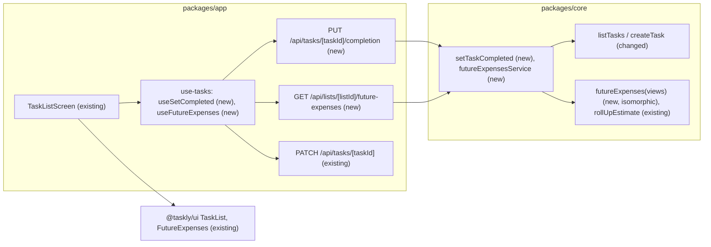

# Completion and future expenses (E03)

- **Date:** 2026-11-03
- **Status:** draft
- **Revised:** 2026-11-03, for the spec review (`.ai/runs/2026-11-03-e03-spec-review.md`, request changes): the future-expenses rule and its service are separate modules (R1), and optimistic completion is shown as server data with the pending completions replayed on top (R2). See Review changes.
- **Superseded in part:** 2026-11-03, by the E02 spec (`2026-11-03-order-markers-and-spaces.md`, audit finding F4): completions do not use a per-tree scope (`completion:<topLevelId>`) but the one queue every task mutation of a list shares (`scope: tasks:<listId>`), because every answer replaces a whole tree. The replay of pending completions is unchanged.
- **Issue:** #13 (stories #20, #21, #47)
- **Depends on:** E01, shipped (`.ai/specs/implemented/2026-10-16-tasks-and-subtasks.md`, #43). E02 (#12) is specified after this spec and builds on it (#17 needs E03-S01).

## 📝 TLDR

The owner, mid-renovation, forgets low-impact tasks and loses what each one costs while choosing what to do next (brief, Problems). Today Taskly lists tasks and subtasks with their estimates, but nothing can be completed and no total exists: `tasks.status` is stored and never read, and `summaryService.ts` is a stub built on the old "spent / upcoming" model. Proposed (future behaviour): the owner completes and reopens tasks and subtasks (#20); one "Future expenses" min–max range, computed on the server over open main tasks with `rollUpEstimate`, sits under the list's name (#21); and a collapsed line under it lists what still has no estimate, each with "Add estimate" (#47). The design system already ships the screens, so the work is `core` services, two routes and the app wiring. No migration.

## ❓ Open Questions

None open. The owner answered the three gate questions on 2026-11-03:

| Id | Question | Answer |
| --- | --- | --- |
| Q1 | One spec or three? | One spec, three phases, one PR per phase. |
| Q2 | Reopening a subtask of a completed task? | (a) The subtask opens and the task stays completed: nothing returns to future expenses, and the subtask is not listed as missing an estimate (R11, R17, D27 as written). The design system keeps those checkboxes active. |
| Q3 | Adding a subtask to a completed task (from another tab)? | The server refuses it with 409, like a move of a completed row (D25). |

## 📝 Problem Statement

- **Need:** the owner forgets low-impact tasks and loses each task's cost while choosing (`[INTERVIEW]` owner, 2026-10-15). The total must leave out what is done (D20, R09) and say what it cannot count yet: a total that silently skips unpriced work looks complete when it is not (R10, R13; H13 `[SYNTHETIC]`; D27).
- **Current code:**
  - `tasks.status` (`task_status` enum `todo | done`, default `todo`) exists since migration `0000`; no service reads or writes it, and `TaskView` does not expose it.
  - `listTasks` and `topLevelView` order by `position COLLATE "C"`, `id`; completed rows must sort after open ones (decision 2026-10-21, point 4).
  - `packages/core/src/summary.ts` (`summarize`, "spent" and "upcoming", exported from `@taskly/core`) and `summaryService.ts` (`listSummary`, `globalSummary`, throwing `NotImplementedError`, exported from `@taskly/core/server`) predate D18/D19. `queryKeys.summary` in the app is unused. They are replaced.
  - `rollUpEstimate` (`estimate.ts`) already ignores status (R14), as E01 required for this epic.
  - `createTask` serializes appends with the list row `FOR NO KEY UPDATE` and holds a subtask's parent `FOR KEY SHARE`; it does not look at the parent's status.
- **Design system (already adapted in #48):** `TaskList`/`TaskRow` with `onToggleComplete` (checkboxes, the "Complete “…” and its N open subtasks?" dialog, no handle and no "Add subtask" on completed rows, rows slide to their new place, focus back on the checkbox), `FutureExpenses` (`total`, `unestimated`, loading/error, focus on the total when the list empties) and `UnestimatedTasks` (D27 wording, "Tiles · Bathroom tiles", the in-place amount form). The design system expects tasks already sorted (open, then completed) and changes shown at once, rolled back with a message in the row when the server refuses (pattern "Optimistic change").

## 📝 Proposed Solution

1. **Completion (#20):** a `core` service `setTaskCompleted` behind the list's `write` role. Completing a task sets it and all its subtasks to `done` in one statement (R09) and writes no `position`. Reopening writes one row: `todo` plus a `position` before its first sibling (decision 2026-10-21, point 4). Views gain `completed` and `position`; reads sort open before completed. Route: `PUT /api/tasks/[taskId]/completion`. The app shows the change at once: the tasks cache holds only server data, and the screen replays the pending completions over it with the same ordering rule.
2. **Future expenses (#21):** a pure `futureExpenses(views)` in an isomorphic `core` module sums `rollUpEstimate` over open main tasks in integer grosze (R17). A separate server-only service reads the list through `listTasks`, so the total and the rows are built from the same views. Route: `GET /api/lists/[listId]/future-expenses`, with its own query key, invalidated whenever a task mutation settles.
3. **What has no estimate (#47):** the same pure function also returns the unestimated items (D27). "Add estimate" goes through the existing `PATCH /api/tasks/[taskId]`, so there is no new write path.

**Alternatives considered:**

- **The total inside `GET /api/lists/[listId]/tasks`:** it would avoid a second request and keep total and rows in one response. Rejected: it changes an existing response into an object (a breaking change under `BACKWARD_COMPATIBILITY.md`), and the design system gives the summary its own loading and error states.
- **Completion through `PATCH /api/tasks/[taskId]` (`{ status }`):** rejected. Completion cascades and writes `position`, while `updateTask` writes only the fields it is sent, so mixing them makes "changed fields only" edits ambiguous. A separate idempotent `PUT` of the target state is simpler to retry.
- **Writing a new `position` after the last sibling on completion:** rejected by the owner on 2026-10-21. It needs the list lock and an extra write per completion; completed rows show in plan order instead.
- **Restoring the whole query snapshot on a failed toggle:** rejected (lesson 2026-10-29). It would drop other pending rows.
- **Writing the optimistic toggle into the cache in `onMutate` and replacing the task with each server answer:** rejected in review (R2). A mutation `scope` queues requests, but queued mutations still run `onMutate` at once. So in "complete, then reopen", the first answer (completed) overwrites the newer reopen while the reopen request is still waiting (lesson 2026-11-03). Reverting "only that change" from captured row states has the same problem when a parent and its subtask overlap.

## 📝 Research (market leaders)

From general knowledge of the products, not re-checked on 2026-11-03:

- **Todoist, TickTick:** completing a parent completes its subtasks, and completed items are hidden by default behind "show completed". Taskly keeps them visible, muted and last (decision 2026-10-21), so the cost of done work stays visible without counting it.
- **Vikunja, Planka (open source):** a done flag and a filter; no money. Nothing to borrow for totals.
- **OpenProject (budgets):** planned cost rolls up the work-package hierarchy beside actual cost. Taskly does the same roll-up as a range and skips actual cost and budgets (E04 / version 2), which keeps this epic free of any payment model.
- **Spreadsheet renovation budgets** (what the owner would use otherwise) count a blank as 0, so the total looks complete. D27's list exists for this.
- **Skipped:** completion dates, history, "completed today" views, recurring tasks. None of them is in the brief's Now scope.

## 📝 Architecture



Takeaway: everything new sits behind the existing authorization (`requireRole` / `requireTaskRole`) and the existing `apiHandler` + Zod response contract. The only shared rule is `rollUpEstimate`, so a row's estimate and the total cannot disagree.

- **`core`:**
  - `tasks.ts` gains `setTaskCompleted`; `listTasks`, `topLevelView` and `createTask` change.
  - Two new modules, split like `estimate.ts` and the services (standards §1, review R1):
    - `futureExpenses.ts`: the pure `futureExpenses(views)`, isomorphic, exported from `@taskly/core` (`index.ts`). It imports only schemas and `estimate.ts`, never `db`.
    - `futureExpensesService.ts`: `futureExpensesService`, `import "server-only"`, exported from `@taskly/core/server` (`server.ts`).
  - Phase 2 checks the production build with the real barrel exports, so a server import cannot reach a client bundle (`barrels.test.ts` covers both entry points).
  - `summary.ts` and `summaryService.ts` are deleted with their tests and exports. Both are internal workspace exports with no consumer (checked: only their own tests import them), which `BACKWARD_COMPATIBILITY.md` allows in the same PR.
- **`app`:**
  - Two route handlers.
  - `use-tasks.ts` gains the completion mutation, the replayed view of the tasks (`useTaskViews`) and the future-expenses query.
  - `task-items.ts` gains the pure `applyCompletion` and `replayCompletions`, and the mapping to `FutureExpenses` props.
  - `queryKeys.summary` becomes `queryKeys.futureExpenses(listId)`.
- **`ui`:** no change. The props exist; the design system's E03 status words in its docs are updated when each phase ships (lesson 2026-10-29).
- **Future work that depends on this:**
  - E02-S01 (#17) uses `completed` to refuse moves (409) and must keep the open-before-completed order in `moveTask`'s neighbour lookup.
  - E02-S02/S03 (markers, spaces) do not touch completion.

## 📝 Data Model

No migration. Existing columns are used as follows:

| Column | Use |
| --- | --- |
| `tasks.status` (`todo` / `done`) | Completed = `done`. Exposed as `completed: boolean`; the enum is not renamed (expand-only). |
| `tasks.position` | Unchanged on completion. On reopen: `positionBetween(null, firstSiblingPosition)`, where the siblings are the row's other siblings in stored order, completed ones included. With no other sibling it is left as is. |

**Read order (both `listTasks` and `topLevelView`):** `ORDER BY (status = 'done'), position COLLATE "C", id`. It is display order only; no row is renumbered. The existing `tasks_list_parent_idx` covers the filter; lists are small (one owner), so no new index.

**Sensitive data:** none added. Titles are already the owner's data and the new responses carry nothing new.

The data-model graph is skipped: no entity or relation changes.

## 📝 API Contracts

All envelopes, error codes and CSRF handling are `apiHandler`'s, unchanged. Schemas live in `@taskly/core` (`schemas.ts`).

### View change (additive, Phase 1)

```ts
subtaskViewSchema += { completed: z.boolean(), position: z.string() }
// taskViewSchema extends subtaskViewSchema, so tasks get both too.
```

`position` is exposed so the client can show completed rows in plan order when it applies a change optimistically. It is opaque to the client: never sent back, never compared except bytewise (JS `<` on these ASCII keys equals `COLLATE "C"`).

### `PUT /api/tasks/[taskId]/completion` (new, Phase 1)

- **Request:** `completionInput = z.strictObject({ completed: z.boolean() })`.
- **Response:** `taskViewSchema`, the top-level task that holds the row (the task, or a subtask's parent), as `updateTask` returns it.
- **Service:** `setTaskCompleted(db, userId, taskId, input)`, `write` role. In one transaction:
  1. Resolve the list (unlocked), `requireRole(…, "write")`, lock the list row `FOR NO KEY UPDATE`, then lock the task `FOR UPDATE`. This is the lock order of `createTask` (membership → list → task). Locking the task before the list would deadlock against a concurrent subtask add, which holds the list and waits for the parent.
  2. If the row already has the target state, write nothing and return the view (an idempotent retry).
  3. **Complete:** `UPDATE tasks SET status = 'done' WHERE id = $task OR parent_id = $task`. For a subtask only its own row changes (R11).
  4. **Reopen:** one `UPDATE` of the row: `status = 'todo'` and the new `position` (Data Model). Its subtasks keep their state (R11, decision 1); a subtask's task stays as it is (Q2).
- **Errors:** an unknown or other user's task → 404 `NotFoundError("Task")`. A unique-position race cannot happen under the list lock; if it ever does, the existing translation gives 409 "Please try again".

### `POST /api/lists/[listId]/tasks` (changed behaviour, Phase 1)

When `parentId` is set, the parent `FOR KEY SHARE` read also returns its `status`. If it is `done` → 409 `ConflictError("Task is completed")` (Q3). After waiting on a concurrent completion's lock, PostgreSQL returns the committed row, so the check sees the new status. The response shape is unchanged.

### `GET /api/lists/[listId]/future-expenses` (new, Phase 2; `unestimated` added in Phase 3)

```ts
futureExpensesResponseSchema = z.object({
  total: estimateViewSchema.nullable(),        // existing: { minGrosze, maxGrosze }, uncapped; null = no open estimated task
  unestimated: z.array(z.object({                // Phase 3
    id: uuid, title: z.string(),
    taskTitle: z.string().optional(),            // set for a subtask
  })),
})
```

- **Service:** `futureExpensesService(db, userId, listId)`, `read` role, calls `listTasks`, then the pure `futureExpenses(views)`.
- **Pure rule:**
  - **Total:** over main tasks with `completed === false`, add up each `estimate` (already the effective estimate from `rollUpEstimate`). Tasks with `estimate === null` are skipped (R10, R13). The result is `null` when nothing was added.
  - **Unestimated, in display order:**
    - an open main task without subtasks and with `estimate === null` → `{ id, title }`;
    - for an open main task with subtasks, each open subtask with `estimate === null` → `{ id, title, taskTitle }`.
    - A task with subtasks is never listed itself (R12). Completed tasks list nothing; completed subtasks are not listed (D27, decision 10).
- **Sum range:** with JS numbers the sum stays exact far beyond any list (each estimate ≤ `MAX_ESTIMATE_GROSZE`); `groszeSchema` is uncapped for totals.
- **Errors:** 404 for a list the user is not a member of (`requireRole`).

### "Add estimate" (Phase 3)

Uses the existing `PATCH /api/tasks/[taskId]` with `{ estimate }`, built by `estimateFromAmounts` (R18). Its existing 409 "A task with subtasks takes its estimate from them" covers an item that gained subtasks meanwhile.

## 📝 UI/UX

Only what this epic adds; the components, wording and states are the design system's (`TaskList.mdx`, `TaskRow.mdx`, `CompleteTaskDialog.mdx`, `FutureExpenses.mdx`, `UnestimatedTasks.mdx`).

Prototype: `prototypes/task-list-v1/`, states s04.25–s04.28 (`.ai/specs/research/decisions/2026-10-21-completed-tasks-order.md`).

- **Layout (decision I1):** page heading (the list's name), then `FutureExpenses`, then quick add, then the list.
- **Completing and reopening (optimistic, review R2):**
  - **Server data only in the cache.** Completion never writes optimistic state into the tasks cache. The cache holds the last server answers (the list, and each mutation's returned `TaskView`). Pending rows of adds (E01) are unchanged.
  - **What the screen shows:** `useTaskViews(listId)` reads the cache and the pending completion mutations' variables in submission order (`useMutationState({ filters: { mutationKey: completionKey(listId), status: "pending" } })`). It shows `replayCompletions(views, pending)`, a fold of `applyCompletion` over them.
    - `applyCompletion(views, { id, completed })` (pure) does what the server does: it flips the row; on a task completion it also completes the task's subtasks; it re-sorts with the server's rule (open first, then `position`).
    - A reopened row goes to the front of its open group under a temporary `positionBetween(null, first)`, which the server's answer replaces.
  - **Server answer:** the hook-level `onSuccess` writes the returned `TaskView` into the cache. TanStack Query runs it before the mutation leaves `pending` (`query-core/src/mutation.ts`), so the screen never shows a gap. The pending completions still in flight are replayed over the new data, so a newer toggle is never overwritten. The same holds for any other answer or refetch (an edit, an add, the list invalidation).
  - **Order of requests:** completions of one top-level task and its subtasks share one `scope` (`completion:<topLevelId>`), so a parent's completion and a subtask's toggle reach the server in the order they were made. Tasks in different trees do not wait for each other.
  - **Invalidation:** after a completion settles, the list is invalidated (skipped while other task mutations are running, as today).
  - **Callbacks:** all callbacks are hook-level options, not per-call `mutateAsync` callbacks (lesson 2026-10-30: per-call ones fire only for the observer's last call).
- **Refused (s04.28):** a failed completion leaves `pending`, so it is no longer replayed and its row goes back by itself. Completions queued after it are still replayed over the server data, so a rollback never undoes a newer toggle, including where a parent and its subtask overlap. The hook-level `onError` sets the row message "Could not save “…”. It is back as it was." and invalidates the list. A 404 refetches and the row disappears with the existing "gone" message.
- **Subtask add refused by Q3's 409:** the subtask form closes because the refetched task is completed, and the row shows "Could not add “…”. “…” is completed." (the app's row notice, like the roll-up messages).
- **Future expenses:**
  - `useFutureExpenses(listId)` maps the response to `FutureExpenses` props: the total is formatted at the edge with `formatPlnRange`, which shows one amount when min = max (R18); `null` → "No estimates yet".
  - The query is invalidated when any task mutation settles (create, update, delete, completion). It is not skipped while others run, since it holds no optimistic state. The total is never computed on the client.
  - A failed load shows the component's error with "Try again"; the task list is unaffected.
- **Add estimate (Phase 3):**
  - `validate` wraps `estimateFromAmounts`; `onAddEstimate` calls the update mutation, and then waits for the future-expenses refetch, because the design system keeps the form busy until the item leaves `items`.
  - On a 409/404 the form shows the server's message and both queries refetch.
  - When the last item goes, focus moves to the total (design system).

## 📝 Edge Cases & Failure Scenarios

| Case | Behaviour |
| --- | --- |
| Complete a task with open subtasks | The design system asks first (AC8); cancelling sends nothing. |
| Complete a task whose subtasks are all completed, then reopen it | The task reopens, its subtasks stay completed, and its full summed estimate returns to the total (decision 1, R14). |
| Reopen a subtask of a completed task (Q2) | The subtask opens and sorts first among its siblings; the task stays completed and is still out of the total; the subtask is not listed as unestimated. |
| Complete only subtasks | The task's figure and the total do not change (R14). |
| Same-state request (double click, retry) | No write; the current view is returned. |
| Two reopens in one list at once | Serialized by the list lock; each gets a distinct position before its first sibling. |
| Completion vs. a subtask add on the same task | Lock order list → task. If the add commits first, the completion completes the new subtask too. If the completion commits first, the add gets 409 (Q3). There is no deadlock. |
| Completion vs. an estimate edit of a subtask | Both lock rows `FOR UPDATE`; the later one waits. The total reflects both after the refetch. |
| Completion request fails (network, 5xx) | The row is reverted with the s04.28 message; the total is refetched and unchanged. |
| Complete → reopen quickly, the first answer delayed | The screen shows reopened throughout: the first answer (completed) lands in the cache and the still-pending reopen is replayed over it. The reopen request is sent after the first answer (shared scope), and its answer is final. |
| Complete → reopen quickly, one of them fails | If the first fails, it drops out and the reopen is replayed over the server data; the scope still sends the reopen. If the second fails, the row shows the first answer. In both cases the row ends as the server holds it, with the s04.28 message. |
| A parent completed while one of its subtasks is toggled | Same scope, so the requests reach the server in order; the screen replays both in order, so it matches what the server will hold. |
| An unrelated edit or add answer arrives while a completion is pending | The answer replaces its task in the cache, and the pending completion is replayed over it, so the row keeps its optimistic state. |
| Future-expenses request fails | The summary shows "Could not load future expenses." with "Try again"; the list works. |
| An unestimated item was completed, deleted or given subtasks in another tab | Completed: the `PATCH` succeeds (editing completed rows is allowed) and the item leaves the list on refetch. Deleted: 404, message, refetch. Given subtasks: 409, the server's message, refetch, and its subtasks are listed instead. |
| Every task completed | "No estimates yet" (`FutureExpenses.mdx`, decision J2); the unestimated line is hidden. |
| An exact price of 0 zł | Counted as 0 and not listed (an estimate exists); it shows as "0 zł". |
| Old client (PWA cache) after deploy | The new view fields are additive, so old clients ignore them; old clients have no completion calls. |

## 📝 Risks & Impact Review

- **Money (risk-high, #21/#47):**
  - A wrong total misleads every planning decision. It is mitigated by one shared pure function (`rollUpEstimate` + `futureExpenses`), integer grosze end to end, formatting only at the edge, and unit tests for each of the R10/R12–R18 cases plus integration tests through HTTP.
  - "Add estimate" reuses the existing write path and its validation.
- **Ordering:**
  - The new read order (`status`, then `position`) is a display rule that E02's `moveTask` must respect when it picks neighbours (noted under Architecture).
  - Reopen writes a normal fractional key, so the key scheme and collation are unchanged (protected surface "Ordering").
- **HTTP API:** additive only (two routes, two view fields). The 409 on adding a subtask under a completed task is new behaviour on an existing route; no client can trigger it today, since nothing completes tasks before Phase 1.
- **Reversibility:**
  - No schema change. Reverting a phase's PR leaves data the old code can read: `done` rows would show as open again, and reopened positions are ordinary keys.
  - Undo for the user is the reverse toggle; R11 means reopening a task does not undo the cascade. This is the owner's rule (decision 1), not a defect.
- **Deleted code:** `summarize`, `listSummary` and `globalSummary` have no consumers. Removing them in Phase 2 is allowed for internal workspace exports.
- **Resource limits:** one extra small `GET` per mutation; the service reuses `listTasks` (one query). No cache, no new dependency.
- **Product direction vs. rule violations:** none found. Q2/Q3 are product calls, answered by the owner.

## 📝 Decisions in play

Relied on (owner approval already given; no superseding proposed):

- D18, D19: naming, and future expenses as the only summary.
- D20, R09: completing a task completes its subtasks and removes it from future expenses.
- R10, R13: unestimated items are left out.
- R11 (confirmed 2026-11-03): subtasks completed alone; no auto-complete; reopening does not reopen subtasks.
- R12, R14, R15, R17, R18: the roll-up, completed subtasks still counting, future expenses and exact prices.
- D25: the server refuses work on completed rows. Q3 extends this to subtask adds; owner-approved 2026-11-03.
- D27: the unestimated list.
- Decision records `2026-10-21-completed-tasks-order.md` (points 1–7) and `2026-11-03-e02-e03-epic-alignment.md` (decisions 1–3, 9–10).

Owner of all of them: the product owner.

## ✅ Acceptance criteria

The issues' criteria, unchanged, are binding: **#20 AC1–AC13, #21 AC1–AC7, #47 AC1–AC9**. Added by this spec's answers:

- **Q2-1:** Given a completed task with completed subtasks, when the owner reopens one subtask, then that subtask is open and first among its task's subtasks, the task stays completed, the total does not change, and the subtask is not listed as unestimated.
- **Q3-1:** Given a completed task, when a request to add a subtask to it reaches the server, then it is refused with 409 and no row is written.
- **C-1 (concurrency):** a completion racing a subtask add on the same task ends in one of the two orders above, never in a deadlock or an open subtask the completion missed.

## 📋 Phasing

- **Phase 1: completion (#20).** Shippable alone: the owner completes and reopens; no total yet.
- **Phase 2: future expenses (#21).** Shippable alone on top of Phase 1: the total, with the unestimated line hidden (`unestimated: []`).
- **Phase 3: what has no estimate (#47).** Adds `unestimated` to the response (additive) and wires "Add estimate".

Each phase is one PR against `auto`, closes its story, runs the full gate (`AGENTS.md`), and closes with `npm run build && npm run test:integration` (lesson 2026-10-28).

## 📋 Implementation Plan

### Phase 1: completion (#20)

1. **Views expose completion and order.** Add `completed` and `position` to the view columns, `subtaskView` and the schemas; order `listTasks` and `topLevelView` by `(status = 'done'), position COLLATE "C", id`; map `completed` in `toTaskItem`. Tests: SQL text over the fake pg client (lesson 2026-10-29), schema tests, a mapping test. App unchanged for the user (no checkboxes yet).
2. **`setTaskCompleted` service.** Add `completionInput` and the service with the lock order, the no-op on same state, the cascade, and the reopen position. Unit tests cover success, the no-op, 404 for another user's or an unknown task, cascade SQL, and the reopen position. Integration tests (`tasks.integration.test.ts`) cover AC1–7 and AC9–13, Q2-1, and two concurrent reopens.
3. **Refuse a subtask under a completed task.** In `createTask`, read the parent's status and refuse with 409. Tests: unit, integration Q3-1, and the C-1 race in both orders (row-lock holder technique, lesson 2026-10-30).
4. **Route.** Add `app/api/tasks/[taskId]/completion/route.ts` (`PUT`, `taskViewSchema`) and its route unit test; cover the HTTP cases (200, 404, 400 bad body, 401, CSRF header) in `test/tasks-http.integration.test.ts`.
5. **App wiring.** Add `applyCompletion` and `replayCompletions` (pure, in `task-items.ts`); `useSetCompleted` (no cache writes in `onMutate`, a shared `scope` per top-level task, hook-level `onSuccess` writing the answer, `onError` message, the invalidation rule); `useTaskViews` (the cache with pending completions replayed); `onToggleComplete` on `TaskList`; the s04.28 row message and the Q3 row notice. Unit tests at 100%.
   - Regression cases from review R2 go in `use-tasks.test.tsx`, run with a real `QueryClient` and controllable responses:
     - complete → reopen with the first answer delayed;
     - both failure orderings (the first fails, the second fails);
     - a parent completion while one of its subtasks is toggled;
     - an unrelated edit answer while a completion is pending;
     - a refusal while an add is pending.
6. **Browser test.** Add a new `test/completion-browser.integration.test.ts`: AC8 dialog and cancel, AC9–12 order, Q2-1, a refused completion (server stopped or forced 500), and complete → reopen with the first response delayed (agent-browser network routing), ending reopened on screen and on the server. Update the design-system docs' E03 status words for #20. Full gate. Manual check in the running app.

### Phase 2: future expenses (#21)

7. **Pure rule and service.** Add `futureExpenses.ts` (pure `futureExpenses(views)`, `total` only in this phase, exported from `@taskly/core`) and `futureExpensesService.ts` (`server-only`, exported from `@taskly/core/server`). Delete `summary.ts`, `summaryService.ts`, their tests and exports; update `barrels.test.ts`. Unit tests cover #21 AC1–5 and AC7 as views → total, plus 404 and an integration test for each.
8. **Route.** Add `app/api/lists/[listId]/future-expenses/route.ts` (`GET`, `futureExpensesResponseSchema`), a route unit test and the HTTP integration cases.
9. **App wiring.** Check `npm run build` with the new barrels. Rename `queryKeys.summary` to `queryKeys.futureExpenses`; add `useFutureExpenses`; place `FutureExpenses` under the heading with `unestimated={[]}`; add the invalidation from every task mutation; handle loading and error with retry. Unit tests at 100%.
10. **Browser test.** The total follows add, edit, delete, complete and reopen (#21 AC1–AC7, #20 AC7). Design-system docs status words for #21. Full gate, manual check.

### Phase 3: what has no estimate (#47)

11. **Unestimated items.** Extend the pure function and the schema with `unestimated`. Unit tests for #47 AC1–3, AC5, AC7 and Q2-1's "not listed", plus the display order.
12. **App wiring.** Pass `unestimated`; implement `validate` and `onAddEstimate` through the update mutation, waiting for the future-expenses refetch; handle 409/404. Unit tests at 100%.
13. **Browser test and wrap-up.** #47 AC4, AC6, AC8, AC9 (wording, collapsed by default, hidden when empty, focus to the total after the last item). Update the design-system docs' status words and `backlog.md` notes. Move this spec to `specs/implemented/` and grep for its filename (lesson 2026-10-29). Full gate, manual check.

## 🔍 Review changes (2026-11-03)

Source: `.ai/runs/2026-11-03-e03-spec-review.md` (verdict: request changes; two major findings, no blocker). Both are applied:

| Id | Finding | Change |
| --- | --- | --- |
| R1 | The draft put the isomorphic `futureExpenses` helper and the database service in one module, against standards §1 (two entry points in `core`). | Two modules: `futureExpenses.ts` (`@taskly/core`) and `futureExpensesService.ts` (`server-only`, `@taskly/core/server`); Phase 2 checks the build with the real barrels (Architecture; steps 7, 9). |
| R2 | Replacing a task with a server answer overwrote newer optimistic toggles. The reviewer's probe: complete → reopen → the complete answer leaves the cache "completed" while the reopen is pending. A `scope` queues requests, not `onMutate`. | The cache holds server data only; the screen replays the pending completions in submission order (`useMutationState`), so answers, refetches and rollbacks never undo a newer toggle. There is one scope per top-level task, for parent/subtask overlap. The reviewer's regression cases are in steps 5 and 6 (UI/UX, Edge cases, Alternatives). |
