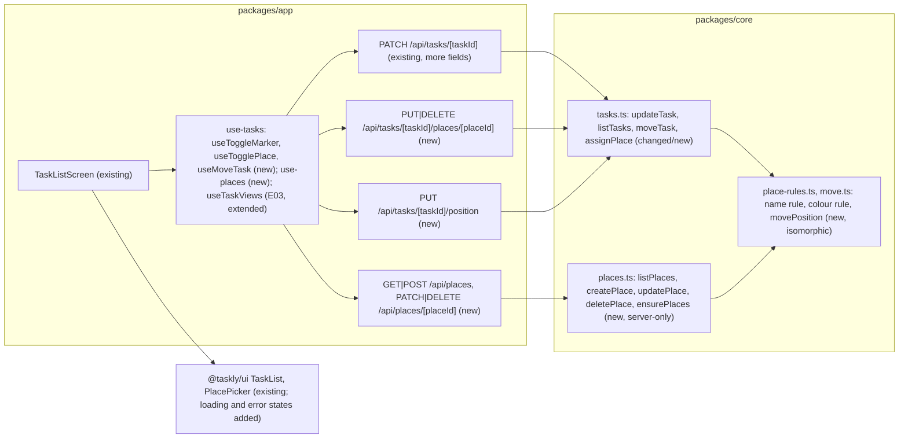
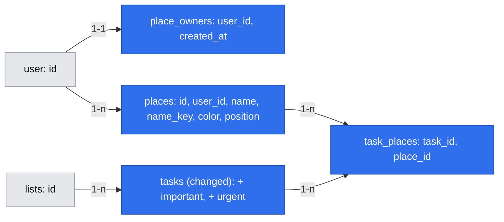

# Order, markers and spaces (E02)

- **Date:** 2026-11-03
- **Status:** ready (owner accepted the revision on 2026-11-03)
- **Revised:** 2026-11-03, for the pre-implementation audit (`.ai/analysis/2026-11-03-pre-implement-order-markers-and-spaces.md`, no-go): places load and fail visibly (F2); places are initialized once, lazily, under one per-user lock, with no backfill (F3); every task mutation of a list shares one queue, so answers land in order (F4); M-1 rewritten and a no-op case added (F5). See Review changes.
- **Revised:** 2026-11-04, after a post-merge review of #53 (owner-approved): a list with a quick add still saving cannot be reordered until the add is saved (P1); place edits patch the cached tasks instead of refetching (P2); malformed place ids answer 404 (P3); the owner check does not assume one owner per list (P4); phase PRs target `main` (P5); smaller contract fixes (P6–P8); the replay skips a tick of a deleted place (P9); the reorder pause covers temporary subtasks (P10). See Review changes.
- **Issue:** #12 (stories #18, #19, #17, in that build order)
- **Depends on:** E01, shipped (`.ai/specs/implemented/2026-10-16-tasks-and-subtasks.md`, #43). Phase 3 (#17) also needs E03 Phase 1 (`.ai/specs/implemented/2026-11-03-completion-and-future-expenses.md`, #20) merged: it reads `completed`, `position` and the open-before-completed order (decision 2026-11-03, point 5). Phases 1 and 2 do not depend on E03.

## 📝 TLDR

The owner has many low-impact tasks and forgets some when choosing what to do next (brief, Problems). Today Taskly lists tasks and subtasks in the order they were added: `moveTask` throws `NotImplementedError`, and tasks have no markers and no spaces. Proposed (future behaviour): the owner marks each task or subtask important and/or urgent (#18, D07); assigns them to several spaces from their own ready, editable list of eight Polish-named spaces (#19, D09, D26); and reorders tasks, and subtasks within their own task, by drag and drop, "Move up / Move down" and the keyboard, with moves of completed rows refused by the server (#17, D25). The design system already ships the screens (`Markers`, `PlacePicker`, `SortableGroup`), so the work is two migrations, `core` services, routes and the app wiring.

## ❓ Open Questions

None open. The owner answered the four gate questions on 2026-11-03:

| Id | Question | Answer |
| --- | --- | --- |
| Q1 | One spec or three? | One spec, three phases, one PR per phase. |
| Q2 | Phase order? | Markers, then spaces, then reorder; reorder waits for E03-S01 (#20). |
| Q3 | Whose spaces are they? | Each user's own (D26 as written). Only spaces of the list's owner can be assigned to its tasks; anyone who can read the list sees the assigned spaces through its tasks. |
| Q4 | #19 "Out of scope: choosing a space's colour" contradicts AC8 and D26 | Dropped from #19 (done 2026-11-03); the owner can change a colour. |

## 📝 Problem Statement

- **Need:** with many low-impact jobs, the owner loses track of what matters and in which order (`[INTERVIEW]` owner, 2026-10-15). Reordering (D01, D25), separate important and urgent markers (D07, the grass-sowing case) and spaces (D09, the curtain rod in three rooms) are the owner's own asks. H4, H11 and H15 (`[SYNTHETIC]`) warn that markers and spaces may be skipped and that fixed spaces may not fit a flat; the editable list (D26) answers H15, H11 stays a hypothesis to watch after release.
- **Current code:**
  - `tasks.position` (fractional key, unique per sibling group, `tasks_sibling_position_uq`, compared `COLLATE "C"`) exists; `createTask` appends under the list row lock `FOR NO KEY UPDATE`. `moveTask` is a stub (`stubs.test.ts`).
  - No marker columns, no spaces table. The E01 spec put spaces in their own many-to-many entity, not lists (E01, Q1).
  - Task mutations (`use-tasks.ts`) share the mutation key `tasks(listId)` but no `scope`, so they run concurrently; each answer replaces its whole tree in the cache (`putTask`).
- **Design system (already adapted in #48, #51):** `TaskRow` takes `onToggleMarker`, `places: PlaceOptions` and `onMove` / `move`; `TaskItem` has `important`, `urgent`, `places`; `Markers`; `PlacePicker` (choose, create without a colour, rename, recolour from 10, delete with "Delete “Garaż”? It is removed from every task.", the limit message at 20); `SortableGroup`, `moveTarget`, `stepTarget`, `rowMove` (dnd-kit; `onMove(id, { afterId, beforeId })`); the row messages "Could not move “…”. It is back where it was." and "Could not save “…”. It is back as it was.". The app writes the name rule and messages (`.storybook/blocks/place-data.ts` shows the examples used below).

## 📝 Proposed Solution

1. **Markers (#18):** two boolean columns on `tasks`. They are written through the existing `PATCH /api/tasks/[taskId]` (`{ important }` or `{ urgent }`), which already writes only the keys it is sent, so two quick toggles of different markers never overwrite each other. Views gain `important` and `urgent`.
2. **Spaces (#19):** a `places` table owned by a user, a `task_places` join table and a one-row-per-user `place_owners` marker. A `core` places service (list, create, rename/recolour, delete) scoped to the session user, and idempotent assign/unassign routes on the task, authorized by the task's list (`write`) plus "the place belongs to the list's owner" (Q3). The eight predefined places are created on the user's first use of their places, once: the `place_owners` row records it and is the lock every place-creating path takes. Views gain `places`.
3. **Reorder (#17):** `moveTask` behind the list's `write` role, under the list lock, with the moved row's new neighbours (`afterId`, `beforeId`) from the client; it checks they are still its open neighbours, computes one new key and writes one row. Completed rows, and neighbours that are not open siblings, are refused with 409. Route: `PUT /api/tasks/[taskId]/position`.
4. **Optimistic changes in the app:** marker toggles, place ticks and moves show at once. The tasks cache holds server data only; the screen replays pending changes over it in submission order (the mechanism E03 specifies for completions, review R2 there). Every task mutation of a list (E01's add, edit and delete too) runs in one queue, `scope: tasks:<listId>`, so the server answers arrive in the order the changes were made and an older tree never lands after a newer one.

**Alternatives considered:**

- **Markers as an enum (`none | important | urgent | both`) or a priority number:** rejected; D07 needs two independent flags, and two booleans let `PATCH` change one without reading the other.
- **A separate markers route (`PUT /api/tasks/[taskId]/markers`):** rejected; the existing `PATCH` already has changed-fields-only semantics and its response. No new surface.
- **Spaces per project list (Q3 b):** rejected by the owner. Sharing later would make editors use the list's spaces; with per-user spaces, a shared list shows its owner's spaces and only those can be assigned.
- **Seeding on read ("if the user has no places, create the eight"):** rejected; an owner who deletes all eight would get them back. The `place_owners` row makes "seeded" durable.
- **Seeding with the default list (`ensureDefaultList`) plus a migration backfill:** rejected in the audit (F3). `POST /api/places` before the first visit would take key `a0` and make the later seed fail or pass the limit, and a user created by the old code between the migration and the new code's start would get no places. Lazy seeding on first use under the `place_owners` lock has neither problem and needs no backfill.
- **Separate queues per tree (`row:<topLevelId>`) and per list for moves:** rejected in the audit (F4). Both return whole trees, so a delayed move answer could land after a confirmed marker and show it unset until the next refetch. Versioned trees (a revision per answer, older ones dropped) would fix it too, but need a new column written by every service; one queue per list needs nothing on the server, and one owner's writes are short.
- **Sending the whole new order of siblings on a move:** rejected by the standards (§5, §6): only the moved row and its neighbours are sent, and one row is written.
- **Client-computed `position`:** rejected; the server must check the neighbours under the lock and must never trust a key that could collide with a completed sibling's.
- **Places' order by name or by creation time:** rejected. Seeded places share one `created_at`, so ties would fall to random UUIDs, and alphabetical order would not keep the owner's list (Salon first). A fractional `position`, as for tasks, keeps the given order and costs one column.
- **Case-insensitive uniqueness with `lower(name)` in PostgreSQL:** rejected; `lower()` follows the database's `LC_CTYPE`, and under `C` it does not fold "Ł". A `name_key` computed in `core` (`normalize("NFC").toLowerCase()`, which folds Polish letters in any locale) with a unique index is the same everywhere.

## 📝 Research (market leaders)

From general knowledge of the products, not re-checked on 2026-11-03:

- **Todoist:** one priority (P1–P4) plus many-to-many labels and manual order inside sections. Its single priority mixes importance and urgency, which D07 separates (as Eisenhower-matrix apps do with two flags). Its labels are per user and shared projects show them to collaborators: the same choice as Q3.
- **Trello, Planka, Wekan (open source):** board labels with a fixed palette of about ten colours and a name, assigned many-to-many. They repeat colours freely and always show the name with the colour, as D26 does. Labels belong to the board there (Q3 b), which the owner rejected for version 1.
- **Linear, Figma, Trello:** fractional ordering keys, one row written per move; a stale move is rebased or refused. Taskly refuses with 409 and refetches; with one owner a refusal is rare.
- **Renovation planners (HomeZada and similar):** organize everything by room, often one room per item. Taskly allows several (D09) and does not filter by room in version 1.
- **Skipped:** filtering or sorting by marker or space, saved views, colour per marker, drag between parents (D25), reordering the places themselves. None is in the brief's Now scope.

## 📝 Architecture



Takeaway: every write sits behind the existing authorization (`requireRole` / `requireTaskRole`) or, for the user-owned places, the session user; every route uses `apiHandler` with a Zod response schema from `@taskly/core`.

- **`core`:**
  - `tasks.ts`: `updateTask` and the views gain markers; `listTasks` and `topLevelView` gain places (one extra query per read, joined in memory); `moveTask` replaces the stub; new `setTaskPlace(db, userId, taskId, placeId, assigned)`.
  - `places.ts` (new, server-only, exported from `@taskly/core/server`): the places service and `ensurePlaces(tx, userId)`, the one initialization and lock step `listPlaces` and `createPlace` start with.
  - `place-rules.ts` (new, isomorphic, `@taskly/core`): `placeNameSchema`, `placeColorSchema`, `placeNameKey`, `PLACE_LIMIT = 20`, `PREDEFINED_PLACES`, `nextPlaceColor(count)`, the messages. The app's `validateName` and the server use the same rule.
  - `move.ts` (new, isomorphic): `movePosition(siblings, id, afterId, beforeId)` over the whole sibling group, the moved row included (`{ id, position, completed }`), the pure neighbour check, no-op check and key choice, used by `moveTask` on locked rows and by the app for the optimistic row.
- **`app`:** six route files; `use-places.ts` (query and the three place mutations); three mutations in `use-tasks.ts`, and the existing add, edit and delete mutations moved into the list queue (`scope: tasks:<listId>`); pending-change kinds in the replay of `useTaskViews`; the mapping of `places`, `important`, `urgent` in `task-items.ts`.
- **`ui`:** no new component. `PlaceOptions` / `PlacePicker` gain `status: "loading" | "error" | "ready"` and `onRetry` (UI/UX, F2), with stories. The epic doc (`E02OrderMarkersPlaces.mdx`) still says "the limit of 10" in its screen map and "Confirm how places relate to project lists" under Remaining product work; both are corrected in Phase 2 (Q3), and the status words when each phase ships (lesson 2026-10-29).
- **Shared with E03:** E03 Phase 1 introduces `useTaskViews` (cache plus pending completions replayed). This epic makes the replay generic over pending changes of several kinds (`completion`, `marker`, `place`, `move`). If Phase 1 here ships before E03 Phase 1, it introduces the generic fold with the `marker` kind and the list queue, and E03 adds `completion` to them; whichever ships second extends, never duplicates. E03's per-tree scope (`completion:<topLevelId>`) is replaced by the list queue (F4): completions also return whole trees, so they must queue with the rest. The ordering rule (open, then `position`, then `id`) is E03's; Phase 3 reuses it.
- **Out of this epic:** SSE events (sharing is not built; `events.ts` stays unused), filtering by marker or space.

## 📝 Data Model

Two migrations, both additive (expand only, `BACKWARD_COMPATIBILITY.md` DB row): `0002` in Phase 1, `0003` in Phase 2.

### `0002`: markers (Phase 1)

| Column | Type | Notes |
| --- | --- | --- |
| `tasks.important` | `boolean NOT NULL DEFAULT false` | D07, D21; existing rows become unmarked. |
| `tasks.urgent` | `boolean NOT NULL DEFAULT false` | Independent of `important`. |

### `0003`: places (Phase 2)

`places` (new):

| Column | Type | Notes |
| --- | --- | --- |
| `id` | `uuid` PK `defaultRandom()` | |
| `user_id` | `text NOT NULL` FK `user.id ON DELETE CASCADE` | The owner (Q3). |
| `name` | `text NOT NULL` | Trimmed, NFC, 1–30 characters (G4). The owner's data, never translated. |
| `name_key` | `text NOT NULL` | `placeNameKey(name)`; unique per user. |
| `color` | `smallint NOT NULL`, `CHECK (color BETWEEN 1 AND 10)` | The design system's `PlaceColor`. |
| `position` | `text NOT NULL` | Fractional key, `COLLATE "C"` in every ordering query; the places' display order. |
| `created_at` | `timestamptz NOT NULL DEFAULT now()` | |

Constraints: `places_user_name_key_uq (user_id, name_key)`, `places_user_position_uq (user_id, position)`.

`task_places` (new):

| Column | Type | Notes |
| --- | --- | --- |
| `task_id` | `uuid NOT NULL` FK `tasks.id ON DELETE CASCADE` | A task or a subtask (D21); deleting a task drops its assignments. |
| `place_id` | `uuid NOT NULL` FK `places.id ON DELETE CASCADE` | Deleting a place removes it from every task (AC7). |
| `created_at` | `timestamptz NOT NULL DEFAULT now()` | |

PK `(task_id, place_id)`; index `task_places_place_idx (place_id)` for the delete cascade. No `list_id`: the task carries it, and the authorization goes through the task.

`place_owners` (new):

| Column | Type | Notes |
| --- | --- | --- |
| `user_id` | `text` PK, FK `user.id ON DELETE CASCADE` | One row per user whose places were initialized. |
| `created_at` | `timestamptz NOT NULL DEFAULT now()` | When the eight were seeded. |

It is the durable "already seeded" marker (deleting every place does not remove it, S-1) and the per-user lock row for creating places. A row lock replaces the advisory lock of the first draft: it lives in the schema, shows in `pg_locks` like the other locks, and needs no hash namespace.

**Rules held in `core`, not the schema:** the limit of 20 per user (checked under the `place_owners` lock); a place assigned to a task belongs to the owner of the task's list (Q3). The schema cannot express the second without a trigger; the only write path checks it, and integration tests try to bypass it.

**Initialization (F3), one protocol for every path:**
- `PREDEFINED_PLACES` = Salon, Sypialnia, Łazienka, Kuchnia, Garaż, Ogródek, Strych, Biuro, with colours 1–8, appended in that order (keys from `positionBetween`).
- `ensurePlaces(tx, userId)` is the first step of `listPlaces` and `createPlace`, in their own transaction:
  1. `INSERT INTO place_owners (user_id) VALUES ($user) ON CONFLICT DO NOTHING RETURNING user_id`.
  2. If the row was inserted, insert the eight places in the same transaction.
  3. `SELECT … FROM place_owners WHERE user_id = $user FOR NO KEY UPDATE` (`createPlace` only; a read needs no user-level lock).
- `updatePlace` and `deletePlace` do not call `ensurePlaces`: a user whose places were never initialized owns no place, so they answer 404 without a write. They need no user-level lock either: rename and delete cannot pass the limit, and duplicates are caught by the unique index.
- A concurrent first use waits on the PK conflict of step 1 until the other transaction commits, then finds the row and does not seed, so the eight are created exactly once. A `POST /api/places` before the first visit seeds first and then appends the new place after `Biuro`, so keys never collide and the limit counts the eight.
- `ensureDefaultList`, sign-up and the task paths do not seed. `setTaskPlace` reads a place that exists or answers 404; `listTasks` reads only assigned places.
- **No backfill:** existing users are initialized on their first use, like new ones. A user created by the old code in the deploy window is therefore handled too, and the migration has no data step.
- **Lock order:** `place_owners` row → `places` rows (`createPlace`); a `places` row alone (`updatePlace`, `deletePlace`); for `setTaskPlace`: membership → task (`requireTaskRole`) → place. No path takes a place lock and then the owner row, so there is no cycle.

**Colour rule (AC8):** a new place gets `nextPlaceColor(n) = (n mod 10) + 1`, where `n` is the user's number of places before it. Eight predefined places → the ninth gets 9, the eleventh 1. After deletions colours can repeat sooner; the name always stands beside the dot (D26). The owner can change it (`PATCH`).

**Sensitive data:** place names are free text written by the owner about their home, like task titles: scoped to the user, never logged (the existing error translation drops pg row details), returned only to the user and to readers of a list that uses them.



Interactive view: `.ai/data-model/2026-11-03-order-markers-and-spaces.html`.

## 📝 API Contracts

All envelopes, error codes and the CSRF header are `apiHandler`'s, unchanged. Schemas live in `@taskly/core` (`schemas.ts`, `place-rules.ts`). All changes to existing shapes are additive.

### View change (additive)

```ts
placeColorSchema = z.number().int().min(1).max(10)   // the design system's PlaceColor
placeViewSchema = z.object({ id: z.uuid(), name: z.string().min(1).max(30), color: placeColorSchema })
subtaskViewSchema += {
  important: z.boolean(), urgent: z.boolean(),   // Phase 1
  places: z.array(placeViewSchema),              // Phase 2, in the places' order (position COLLATE "C", id)
}
```

### `PATCH /api/tasks/[taskId]` (more fields, Phase 1)

`taskFields += { important: z.boolean(), urgent: z.boolean() }`. Only the keys present are written, as today; a body of `{ urgent: false }` leaves `important` alone (AC3). `createTaskInput` does not take them: new tasks start unmarked. Response unchanged (`taskViewSchema` of the top-level task). Allowed on completed rows too.

### Places (Phase 2, session user only; no list role involved)

| Route | Request | Response | Errors |
| --- | --- | --- | --- |
| `GET /api/places` | — | `z.array(placeViewSchema)`, in `position` order; the first call initializes the eight | 401 |
| `POST /api/places` | `z.strictObject({ name: placeNameSchema })` | `placeViewSchema` (colour from `nextPlaceColor`) | 400 name rule; 409 "A place with this name already exists."; 409 "You can have up to 20 places. Delete one to add another." |
| `PATCH /api/places/[placeId]` | `z.strictObject({ name: placeNameSchema, color: placeColorSchema }).partial()`, at least one key | `placeViewSchema` | 400; 404 not the user's place or a malformed id; 409 duplicate name |
| `DELETE /api/places/[placeId]` | — | `z.null()` | 404 not the user's place or a malformed id |

- **Service:** `listPlaces` and `createPlace` start with `ensurePlaces` (Data Model). `createPlace` then holds the `place_owners` row `FOR NO KEY UPDATE` while it counts and appends, so concurrent creates cannot pass 20 and get distinct positions (append after the last, like tasks). `updatePlace` and `deletePlace` lock the place row `FOR UPDATE` where `id = $1 AND user_id = $user`; no row → `NotFoundError("Place")` (fail closed, no existence leak).
- **Malformed ids:** a `placeId` that is not a UUID → `NotFoundError("Place")` before any query, as `requireTaskRole` does for task ids; otherwise PostgreSQL's invalid-uuid error (22P02) is not translated and would answer 500. This applies to every route with a `placeId`.
- **Name rule** (`placeNameSchema`): trim, NFC, not empty ("Enter a name."), at most 30 characters ("Use at most 30 characters."). Duplicates are caught by the unique index (23505 → the 409 above, in a place-specific translation), so a race cannot create two "Kuchnia". The app checks the same rule and the duplicate against its cached places before sending (`validateName`).

### `PUT|DELETE /api/tasks/[taskId]/places/[placeId]` (new, Phase 2)

- **Request:** no body. `PUT` assigns, `DELETE` unassigns; both idempotent (assigning twice or removing an absent place writes nothing and succeeds).
- **Response:** `taskViewSchema` of the top-level task that holds the row.
- **Service:** `setTaskPlace(db, userId, taskId, placeId, assigned)`: `requireTaskRole(…, "write")`; then the place `FOR KEY SHARE` where `id = $place` and `EXISTS` a `list_members` row of the task's list with that place's `user_id` and role `owner`; no row → `NotFoundError("Place")`. The schema does not limit a list to one owner (`list_members` has no unique owner index, and an invitation can carry `owner`), so the check must not be a scalar subquery, which would fail with more than one owner. `INSERT … ON CONFLICT DO NOTHING` / `DELETE`. Nothing is copied to or from subtasks (AC9, D21).
- **Errors:** 404 task (unknown, other user's list), 404 place (unknown, malformed id, someone else's, deleted meanwhile; the place lock makes a concurrent delete wait or win cleanly), 403 for a viewer (`requireRole`).

### `PUT /api/tasks/[taskId]/position` (new, Phase 3)

- **Request:** `moveTaskInput = z.strictObject({ afterId: z.uuid().nullable(), beforeId: z.uuid().nullable() })`, the moved row's new neighbours among its **open** siblings, as `moveTarget` gives them.
- **Response:** `taskViewSchema` of the top-level task that holds the row (the moved task, or a subtask's parent).
- **Service `moveTask`:** one transaction:
  1. Resolve the list (unlocked), `requireRole(…, "write")`, lock the list row `FOR NO KEY UPDATE` (the lock `createTask` and E03's reopen take, so every new key in a list is chosen under it), then the task `FOR UPDATE`.
  2. A completed task or subtask → 409 `ConflictError("Task is completed")` (AC9; the wording E03 uses for a subtask add under a completed task).
  3. Read the row's sibling group (same `list_id`, same `parent_id`, any status, the row included) as `{ id, position, completed }`.
  4. `movePosition(siblings, taskId, afterId, beforeId)`:
     - Both ids must be open siblings other than the row, and adjacent in the open order (`afterId` directly before `beforeId`; a null `afterId` means `beforeId` is the first open sibling, a null `beforeId` that `afterId` is the last). Otherwise → 409 `ConflictError("The list changed. Try again.")`. A neighbour under another parent or at the other level (AC5) fails this check too.
     - Already in that place → no write; return the view.
     - Key: with `afterId`, between `after.position` and the next stored sibling after it (any status); otherwise between the stored sibling before `before` (or the start) and `before.position`. Taking the nearest stored neighbour means the key can never equal a completed sibling's key, and the open order is exactly the one asked for.
  5. One `UPDATE tasks SET position = $key WHERE id = $task` (AC2, AC4).
- **Errors:** 404 task; 403 viewer; 409 as above; a unique-position violation cannot happen under the list lock, and if it ever does the existing translation gives 409 "Please try again".

## 📝 UI/UX

Only what this epic adds; components, wording and states are the design system's (`TaskRow.mdx`, `PlacePicker.mdx`, `Reorder.mdx`, `E02OrderMarkersPlaces.mdx`, decisions G1–G6, H1–H10).

Prototype: `prototypes/task-list-v1/`, states s04.22–s04.24 and s04.29 (`.ai/specs/research/decisions/2026-10-21-completed-tasks-order.md`).

- **Pending changes, shown at once (all three phases):**
  - The tasks cache holds server answers only. `useTaskViews(listId)` shows the cache with the pending changes replayed in submission order, read with `useMutationState` over the tasks mutation keys. Each kind has a pure `apply…` in `task-items.ts`:
    - `marker` `{ id, marker, on }` sets the flag;
    - `place` `{ id, placeId, assigned }` adds the place (from the places cache) or removes it; a change whose place is no longer in the places cache (deleted meanwhile) is skipped, and its request answers 404 place (P9);
    - `move` `{ id, afterId, beforeId }` gives the row the key `movePosition` computes over the current view and re-sorts with the shared rule. If its neighbours are no longer adjacent in the view, the row stays put; the server will refuse.
  - **Server answer:** the hook-level `onSuccess` writes the returned `TaskView` into the cache; the remaining pending changes are replayed over it, so a newer change is never overwritten (lesson 2026-11-03).
  - **One queue per list (F4):** every task mutation of the list, E01's add, edit and delete, E03's completion and this epic's marker, place and move, runs with `scope: { id: "tasks:<listId>" }`. A request is sent only after the previous one settled, so answers reach the cache in submission order: a tree confirmed by a later change is never replaced by an earlier change's tree. Each move's neighbours were picked on a view that includes the earlier changes, so they match what the server holds when it arrives. The one exception is a quick add still saving: its temporary row is outside the move group, so a move to the end would name a last neighbour that is no longer last once the add is saved, and be refused; reordering is therefore off while an add is saving (Reorder, P1). Before writing an answer, the hook cancels an in-flight list refetch (`cancelQueries`, as E01 does), so an older refetch cannot land on top either.
  - **Cost:** changes in one list are sent one at a time. With one owner each request is a short transaction; the screen shows every change at once regardless, so the queue is not visible. Place create, rename and delete (`use-places.ts`) are not in the queue: they return places, not trees, and patch the cached task views afterwards (Places), without a refetch.
  - **E01 behaviour kept:** quick adds still show their temporary rows at once and keep them while queued; the "skip invalidation while other task mutations are pending" rule stays.
  - **Refused or failed:** the change leaves `pending`, so it is no longer replayed and the row goes back by itself. The hook-level `onError` sets the row message (markers and places: "Could not save “…”. It is back as it was."; moves: "Could not move “…”. It is back where it was.", s04.24) and invalidates the list. A 404 refetches and the row disappears with the existing "gone" message; a 404 place also refetches the places.
- **Markers (#18):** "Important" / "Urgent" in "…" (`MenuCheckboxItem`); the meta line shows the words (`Markers`). A subtask's markers are its own (AC4).
- **Places (#19):**
  - `usePlaces()` loads `GET /api/places` once per session (query key `places`), next to the tasks query and independent of it. The row's "Places…" opens `PlacePicker` with `all`, `atLimit = places.length >= PLACE_LIMIT` and `validateName` from `place-rules.ts` plus the cached names.
  - **Loading and failure (F2):** the picker never receives `[]` in place of places it does not have.
    - `PlaceOptions` / `PlacePicker` gain `status: "loading" | "error" | "ready"` and `onRetry`. Only `ready` shows the places, New place and Edit places; an empty `ready` list is the real "No places yet.".
    - `loading` (the first load not answered yet): the picker's title and a `Skeleton` of three place rows (the shared loading pattern).
    - `error`: the shared `ErrorState` inside the picker, "Could not load your places." with "Try again" (`onRetry` refetches; focus stays on "Try again", then moves to the first place when they arrive). The wording follows "Could not load your tasks." (a proposal, English for version 1).
    - The task list, markers, moves and the places already shown on rows (they come from the task views) work whatever the places query does.
    - TanStack Query's default retries run first; `error` shows once they are spent.
  - Create: `POST /api/places`, then the place is added to the places cache and assigned to the task through the `place` change (the design system's `onCreate` = create and tick). If the assignment then fails, the place stays in the list unticked and the row shows the rollback message. A 409 maps to the name field with the server's message.
  - Rename, recolour, delete wait for the server (the picker's "Saving…" / "Deleting…"; not optimistic). On success the places cache is updated and the cached task views are patched with the server's answer: every row holding that place gets its new name or colour (AC6), or loses it on delete (AC7). The patch is a pure function in `task-items.ts`, and the cache still holds only server data. A queued tick of a deleted place is skipped by the replay (P9). The tasks query is not refetched: a refetch here would bypass the "skip while other task mutations are pending" rule and drop the temporary rows of quick adds still saving (P2). Failures use the picker's messages ("Could not save the place. Try again.", "Could not delete the place. Try again.").
  - On a row, places show in the places' order (the view's order), each as a dot and its name (`PlaceTag`).
- **Reorder (#17):** `TaskList` gets `onMove`, and each task row gets `onMove` for its subtasks (G1). Drag from 640 px by the handle, long press on a phone, keyboard on the handle, "Move up / Move down" in "…"; completed and pending rows have no handle and no menu items (s04.29, the design system's rule). After a move from the menu, focus stays on the row (s04.23).
  - **While a quick add is saving (P1):** as long as the list shows a temporary task or subtask (`isPendingTaskId`), the app passes no `onMove` to `TaskList`, so no row of the list has a handle or "Move up / Move down". `TaskList` hands one `onMove` to the top level and to every task's subtasks, so the whole list pauses, not only the add's group: a subtask add under one task also pauses the top level and every other task's subtasks; that needs no design-system change, and an add is saved in well under a second. Reordering returns when the add is saved or fails. Moves already queued are not affected: they were picked before the add, so their neighbours are still valid.
- **Invalidation:** as in E01/E03, the list is invalidated when a task mutation settles, skipped while other task mutations are pending. E03's future-expenses query is not invalidated by these mutations: none of them changes an amount, a completion or a task's existence.

## 📝 Edge Cases & Failure Scenarios

| Case | Behaviour |
| --- | --- |
| Toggle important, then urgent, quickly | Two `PATCH`es with one key each, in order (the list queue); neither overwrites the other; both replayed until answered. |
| Toggle the same marker on and off quickly, the first answer delayed | The screen shows "off" throughout: the first answer lands, the pending "off" is replayed over it, and its answer is final. |
| Mark a subtask; mark a task | Only that row changes (AC4). |
| A user's first use of places | `ensurePlaces` creates the `place_owners` row and the eight in one transaction; two concurrent first uses create them once (the PK conflict waits for the first). |
| `POST /api/places` before the user ever loaded places | The eight are seeded first, then the new place is appended as the ninth with colour 9 (S-2). |
| `POST /api/places` racing the first `GET` | One transaction seeds, the other waits on `place_owners` and then sees nine or eight places; never sixteen, never a key collision (C-1). |
| Places fail to load | "Places…" shows "Could not load your places." with "Try again" inside the picker; no New place, no "No places yet."; the list keeps working (P-1). |
| A move answer is slow and a marker toggle follows | The marker request waits in the list queue until the move's answer is in the cache, then its own answer (with the move) replaces the tree; the marker shows set throughout (F4). |
| An edit answer is slow and a place tick follows | Same: queued after the edit; the tick is replayed over the edit's tree until its own answer lands. |
| An owner who deleted all eight places | They do not come back; the picker shows "No places yet." |
| Create "łazienka" next to "Łazienka" | The app's rule refuses it under the field; a racing request gets 409 from the unique index, shown under the field (AC5). |
| Rename "Kuchnia" to "kuchnia" (same place, case only) | Allowed: the duplicate check ignores the place itself. |
| A name with surrounding spaces, or "Ł" composed differently (NFD) | Trimmed and NFC-normalized before the key is computed, so "Łazienka" in either form is one name. |
| The 21st place, or two creates racing at 19 | The per-user lock serializes them; the second gets the limit message (AC10). The picker already shows the limit message at 20. |
| Delete a place assigned to 4 tasks | The picker asks first (AC7); on confirmation one `DELETE`; the cascade removes the 4 assignments; the tasks keep their other places after the refetch. |
| Tick a place another tab just deleted | 404 "Place"; the tick rolls back with the row message, and places and tasks refetch. |
| Assign a place that belongs to someone else (crafted request) | 404, nothing written. |
| Delete a task with places | Its `task_places` rows go with it (cascade); the places stay. |
| Move to where the row already is | No write. |
| Two moves in one tab, the second before the first is answered | The list queue: the second is sent after the first, with neighbours from the view that already shows the first, so both pass. |
| A move whose neighbours changed in another tab | If the asked neighbours are no longer adjacent (another row now sits between them), 409 "The list changed. Try again."; the row goes back with the s04.24 message and the list refetches (M-1). If they are still adjacent, the move is valid, or a no-op when the row already sits there (M-2). A neighbour that moved elsewhere is not detectable without versioned requests, and does not need to be: the asked order is still what the owner sees after the refetch. |
| A move next to a completed sibling's stored key | The key is taken between the nearest stored neighbours, so it never collides; display order is open first. |
| Move a completed row (crafted, or completed in another tab) | 409 "Task is completed", no `position` changes (AC9); the row goes back. |
| A subtask moved into another task or to the top level (crafted) | The neighbours are not its open siblings → 409, nothing changes (AC5). |
| Move an open subtask of a completed task (E03 Q2) | Allowed: the subtask is open. |
| Move vs. a quick add in the same list | Both take the list lock; the add appends after the last stored sibling, the move gets a key between its neighbours; no collision. |
| A quick add is saving, then the owner tries to move a row | Not possible: while the temporary row shows, the list has no handles and no "Move up / Move down" (P1). Without this, "Move down" into the last place would send `beforeId: null` for a row that is no longer last once the add is saved, and the server would refuse it. Reordering returns when the add settles. |
| A quick add of a subtask is saving, then the owner tries to move a task or another subtask | Not possible either: the temporary subtask pauses the whole list, since `TaskList` has one `onMove` (P10). |
| A place is renamed or deleted while a quick add is saving | The cached rows are patched with the new name, or lose the place; the temporary row stays (P2). |
| A place is deleted while a tick of it is still queued | The replay skips the tick, since the place is no longer in the places cache; when the tick is sent, it answers 404 place, which refetches the tasks and the places (P9). |
| A malformed `placeId` in a URL (crafted) | 404 "Place", nothing written (P3). |
| A list with two `owner` rows (not possible from the app today) | The assign check accepts a place of any of the owners; it never fails on the number of owners (P4). |
| A move request fails (network, 5xx) | The row goes back with the s04.24 message. |
| Old client (PWA cache) after deploy | New view fields are additive; old clients ignore them and have no new calls. |
| Migration `0003` on a database with users | Only new tables; existing users get the eight on their first use, as new users do. The old code running between the migration and the restart never touches places. |

## 📝 Risks & Impact Review

- **Schema (risk-high, #18, #19):** two additive migrations, no change to existing columns or constraints. Rollback: revert the PR and run the down SQL (drop `task_places`, `places`, `place_owners`; drop the two columns), written into the run log and tried once by hand, as for `0001`. Data entered meanwhile (markers, places) is lost on rollback; that is the accepted cost of a down migration, stated in the PR.
- **Authorization:** places are the first entity owned by a user rather than a list. The rule "a place assigned to a task belongs to the list's owner" lives in one service function and is tested on the denied paths (another user's place, viewer, non-member). When sharing is built, editors can tick the owner's places but not edit them; that is Q3's answer, recorded here so the sharing spec starts from it.
- **Better Auth tables:** only a FK from `places.user_id` to `user.id` with cascade; no change to auth tables or sessions (`BACKWARD_COMPATIBILITY.md` Auth row untouched).
- **Ordering (protected surface):** the key scheme and collation are unchanged; one row per move; places use the same scheme.
- **HTTP API:** additive only (six routes, four view fields, two `PATCH` fields).
- **Coupling with E03:** the generic replay and the list queue must be written once. Whichever epic ships its first phase second extends it (Architecture). The risk is two parallel implementations; the reviewer of the second PR checks for it. The list queue replaces the per-tree scope in the E03 spec; that spec gets a one-line revision note pointing here in the same docs PR, so whoever builds E03 first builds the queue.
- **Queue cost:** serializing a list's writes adds one request's latency per queued change on a slow connection. It is invisible on screen (changes show at once) and bounded by how fast one person clicks; it changes E01's concurrent adds into queued ones, covered by E01's existing browser tests rerun in Phase 1.
- **Deployment (F3):** no ordering step is needed between the migration and the new code, because nothing is backfilled and the old code never reads the new tables.
- **Resource limits:** one extra query per task read (`task_places` join `places` for the list), one small places query per session; no cache, no new dependency (`fractional-indexing` and dnd-kit are installed).
- **Product calls vs. rule violations:** none found against the repository rules. H11 (markers and places skipped) is a product risk to watch, not a defect.

## 📝 Decisions in play

Relied on (owner approval already given; no superseding proposed):

- D01, D25: reordering; subtasks only within their own task; completed rows cannot be moved, the server refuses.
- D07: two independent markers.
- D09, D26: several spaces per task; the per-owner predefined, editable list, unique names ignoring case, colours in turn from 10, at most 20.
- D21: subtasks have their own markers and spaces; no inheritance (decision 2026-11-03, point 7).
- Decision records `2026-10-21-completed-tasks-order.md` (points 5–6) and `2026-11-03-e02-e03-epic-alignment.md` (decisions 3–7).
- This spec's Q3 (per-user places, only the list owner's assignable) and Q4 (#19 out-of-scope line dropped), owner-approved 2026-11-03.

Owner of all of them: the product owner.

## ✅ Acceptance criteria

The issues' criteria are binding: **#18 AC1–AC4, #19 AC1–AC10, #17 AC1–AC9**. Added by this spec:

- **Q3-1:** Given a list and a place that does not belong to the list's owner, when a request to assign it to one of the list's tasks reaches the server, then it is refused with 404 and nothing is written.
- **S-1 (seeding once):** Given an owner who deleted every place, when they reload, then they still have no places.
- **S-2 (create before first use):** Given a user who never loaded places, when they create "Jadalnia", then they have the eight predefined places and Jadalnia ninth, with colour 9.
- **C-1 (concurrency):** two creates racing at 19 places end with 20 places and one limit refusal; a create racing the first load seeds the eight once; two moves racing in one list never give two siblings the same `position`.
- **M-1 (stale move):** Given open tasks A, B, C, D, when another client moves B after D (A, C, D, B) and then a move of C between A and B arrives, then it is refused with 409 and no `position` changes (D now sits between A and B).
- **M-2 (already in place):** Given open tasks A, B, C, when another client moves B after C (A, C, B) and then a move of C between A and B arrives, then it succeeds with no write and the order stays A, C, B.
- **P-1 (places unavailable):** Given the places request fails, when the owner opens "Places…", then the picker shows "Could not load your places." with "Try again", not "No places yet." or New place; "Try again" loads the places and shows them; the task list works throughout.
- **Q-1 (answers in order):** Given a move and then a marker toggle on the same tree, with the move's answer delayed, then the marker request is not sent before the move's answer is in, and the row never shows the marker unset, before or after any refetch.
- **M-3 (no reorder while an add is saving):** Given open tasks A, B, C and a quick add of D still saving, then no row shows a drag handle or "Move up / Move down"; when D is saved, "Move down" on B moves it after C and the server accepts it. The same holds for a quick add of a subtask under A: while it saves, neither the tasks nor any subtasks show a handle or move items.

## 📋 Phasing

- **Phase 1: markers (#18).** Shippable alone; no E03 dependency.
- **Phase 2: spaces (#19).** Shippable alone; no E03 dependency.
- **Phase 3: reorder (#17).** Starts after E03 Phase 1 (#20) is merged.

Each phase is one PR against `main`, labelled `risk-high` for Phases 1–2 (migrations) and `risk-medium` for Phase 3, closes its story, runs the full gate (`AGENTS.md`) and a manual check in the running app.

## 📋 Implementation Plan

### Phase 1: markers (#18)

1. **Migration `0002`.** Add `important`, `urgent` to `schema.ts`; `npm run generate -w @taskly/db -- --name=task_markers` (lesson 2026-10-29); review the SQL. `schema.integration.test.ts`: defaults false, NOT NULL. Upgrade test under Testcontainers: rows from `0001` survive with both false. Down SQL in the run log, tried once.
2. **Views and `PATCH`.** Add the columns to `viewColumns`, `subtaskView`, `subtaskViewSchema`; add `important`, `urgent` to `taskFields` and `updateTask`'s changes. Unit tests: SQL over the fake pg client, schema tests (a body of only `{ urgent: false }` is valid and writes one column). Integration: AC1–AC4 through `updateTask`, viewer 403, non-member 404.
3. **List queue and pending-change replay.** Put every task mutation (E01's add, edit, delete; E03's completion if shipped) in `scope: tasks:<listId>`, with `cancelQueries` before an answer is written. If E03 Phase 1 has shipped, add the `marker` kind to `useTaskViews`; otherwise introduce `useTaskViews` with the generic fold and the `marker` kind (E03 adds `completion`). Unit tests with a real `QueryClient` and held responses: on/off with the first answer delayed; important then urgent; a failure rolling back only its own change; a delayed edit answer followed by a marker toggle (the toggle is sent only after the edit's answer, and the marker never shows unset); a list refetch started before an answer and resolving after it. Rerun E01's browser tests (quick adds now queue).
4. **App wiring.** `useToggleMarker` (hook-level callbacks only, lesson 2026-10-30); `onToggleMarker` on `TaskList`; map `important`, `urgent` in `toTaskItem`; the row message on failure. Unit tests at 100%.
5. **Browser test and wrap-up.** `test/markers-browser.integration.test.ts`: set and clear each marker on a task and a subtask, reload, AC4; a refused toggle (forced 500) rolls back with the message. Design-system status words for #18. Full gate, manual check.

### Phase 2: spaces (#19)

6. **Migration `0003`.** `places`, `task_places`, `place_owners`, constraints; no data step. Generate, review (FK and index order). Integration: the checks and unique keys, cascades from task, place and user; the upgrade test: rows from `0002` survive and a user from before the migration has no places until first use. Down SQL in the run log.
7. **Rules (isomorphic).** `place-rules.ts`: `placeNameSchema`, `placeNameKey`, `nextPlaceColor`, `PLACE_LIMIT`, `PREDEFINED_PLACES`, messages; exported from `@taskly/core`. Unit tests: trim, NFC, 30 characters, "Łazienka" = "łazienka", NFD = NFC, colours 9, 10, 1.
8. **Places service.** `places.ts` (`server-only`): `ensurePlaces` (the `place_owners` insert, the seed, the lock), `listPlaces`, `createPlace` (owner-row lock, limit, append key, colour), `updatePlace`, `deletePlace`; the 23505 translation to the duplicate-name 409. Unit tests (SQL and lock clauses over the fake pg client); integration: AC1 (a user's eight on first use, each user their own), AC4, AC5, AC6, AC8, AC10, S-1, S-2, C-1 (creates racing at 19; a create racing the first load, both orders, with the row-lock holder technique, lesson 2026-10-30), another user's place → 404 on update and delete; a malformed `placeId` → 404; update and delete by a user who never loaded places → 404 with no `place_owners` row written.
9. **Task places.** `setTaskPlace`; views gain `places` (one extra query in `listTasks` and `topLevelView`, in place order). Integration: AC2, AC3, AC7 (delete keeps the other places), AC9, Q3-1, a list with two `owner` rows (either owner's place assigns, no SQL error; P4), viewer 403, idempotent repeats, delete vs. assign race (the place lock).
10. **Routes.** `app/api/places/route.ts` (`GET`, `POST`), `app/api/places/[placeId]/route.ts` (`PATCH`, `DELETE`), `app/api/tasks/[taskId]/places/[placeId]/route.ts` (`PUT`, `DELETE`); route unit tests; HTTP integration cases (200, 400, 401, 404 including a malformed `placeId`, 409, CSRF header) in `test/places-http.integration.test.ts`.
11. **Picker loading and error (design system).** `PlaceOptions` / `PlacePicker` gain `status` and `onRetry`; the `loading` skeleton and the `error` state with "Try again" (shared `Skeleton`, `ErrorState`); stories "Loading" and "Load Failed" and the state table in `PlacePicker.mdx`; component tests (no New place and no "No places yet." outside `ready`; focus after retry). 100% coverage in `packages/ui`.
12. **App wiring.** `use-places.ts` (query, create, update, delete); `useTogglePlace` in the list queue with the `place` kind in the replay; `places` on `TaskList` (`PlaceOptions`, `status` from the query); create-and-tick; 409 → the name field; the pure patch of cached task views after rename, recolour and delete (no tasks refetch); `toTaskItem` maps places. Unit tests at 100%, including create succeeding and the tick failing, a rename and a delete while a quick add is saving (the temporary row stays, rows show the change), a delete while a tick of the same place is queued (the replay skips it, no error; the 404 answer refetches) (P9), and the places query delayed, failing, then retried (P-1).
13. **Browser test and wrap-up.** `test/places-browser.integration.test.ts`: the eight on first use, AC2 with a new place Jadalnia, AC3, AC5 message, AC6 rename visible on the row, AC7 question and result, AC8 colour change, AC9, AC10 at 20, P-1 (the places route aborted, then restored). Correct `E02OrderMarkersPlaces.mdx` (limit 20, the Q3 answer); status words for #19. Full gate, manual check.

### Phase 3: reorder (#17, after E03 Phase 1)

14. **`movePosition` (isomorphic).** `move.ts`: `movePosition(siblings, id, afterId, beforeId)`, the neighbour check, no-op check and key choice over the whole sibling group `{ id, position, completed }`, the moved row included. Unit tests: first, last, middle, both null with no open siblings, no-op, stale neighbours, a neighbour that is completed or the row itself, completed siblings stored between the neighbours (key never equal to theirs, open order as asked).
15. **`moveTask` service.** Replace the stub (remove it from `stubs.test.ts`): `moveTaskInput`, the lock order, the completed refusal, the sibling read, one `UPDATE`. Unit tests over the fake pg client (lock clauses, `COLLATE "C"`, one update). Integration: AC1, AC2 (positions of all other rows unchanged), AC4, AC5, AC9, M-1 (A, C, D, B → 409), M-2 (A, C, B → success, no write), C-1 (two concurrent moves), viewer 403, non-member 404.
16. **Route.** `app/api/tasks/[taskId]/position/route.ts` (`PUT`, `taskViewSchema`); route unit test; HTTP integration cases.
17. **App wiring.** `useMoveTask` in the list queue with the `move` kind in the replay; `onMove` on `TaskList` and per task for subtasks; no `onMove` while the list shows a temporary row (P1); the s04.24 message; invalidation. Unit tests at 100%, including M-3 (no handles or move items while an add of a task or of a subtask is saving, back after it is saved and after it fails); two quick moves with the first answer delayed; a refused move; Q-1 (a delayed move answer, then a marker toggle on the same tree); a subtask move followed by its parent's completion with the move's answer delayed; a move while a completion of the same row is pending (refused by the server, rolled back).
18. **Browser test and wrap-up.** `test/reorder-browser.integration.test.ts`: AC1 by keyboard on the handle and reload, AC4 for subtasks, AC6 "Move up / Move down" and focus, AC8 (no handle or menu items on a completed row), a refused move (stale, via a second request) rolling back with the message. AC7's long press and pointer drag are covered by the design system's interaction stories and a manual check on a phone-sized viewport (recorded in the run log). Status words for #17; `backlog.md` notes. Move this spec to `specs/implemented/` and grep for its filename (lesson 2026-10-29). Full gate, manual check.

## 🔍 Review changes (2026-11-03)

Source: `.ai/analysis/2026-11-03-pre-implement-order-markers-and-spaces.md` (`om-pre-implement-spec`, readiness no-go; five findings). All are applied:

| Id | Finding | Change |
| --- | --- | --- |
| F1 | Status `draft` does not allow implementation. | `ready`: the owner accepted this revision on 2026-11-03. |
| F2 | No contract for the places' first load and failure; `PlacePicker` takes only a ready array, and `[]` would read as "No places yet." | `PlaceOptions` / `PlacePicker` gain `status` and `onRetry` with a skeleton and "Could not load your places." / "Try again"; the task list is unaffected (UI/UX; P-1; steps 11–13). |
| F3 | Seeding with the default list collides with `POST /api/places` before the first visit (key `a0`, the limit) and with the deploy window. | A `place_owners` row per user: the durable seeded marker and the one lock for creating places; `ensurePlaces` starts every places operation; no backfill (Data Model; S-2, C-1; steps 6, 8). |
| F4 | Separate scopes let a delayed move's tree overwrite a confirmed marker. | One queue per list for every task mutation, E01's and E03's included, plus `cancelQueries` before writing an answer (UI/UX, Architecture, Risks; Q-1; steps 3, 17). The E03 spec's per-tree scope is replaced; a note there points here. |
| F5 | M-1 asked for 409 where the algorithm gives a valid no-op (A, C, B). | M-1 now uses A, C, D, B (D between the neighbours → 409); M-2 covers the no-op (Acceptance criteria, Edge cases, step 15). A neighbour that only moved elsewhere is not treated as a conflict. |

## 🔍 Review changes (2026-11-04, post-merge review of #53)

Source: the read-only post-merge review of #53 on 2026-11-04 (one major, four minor, three nits), and the review of #55 (two minor, P9–P10). The owner chose P1's option and approved the rest:

| Id | Finding | Change |
| --- | --- | --- |
| P1 (major) | A move picked while a quick add was saving left out the temporary row, so "Move down" into the last place sent `beforeId: null` and was refused once the add was saved, contradicting "neighbours match what the server holds". | Owner's choice (a): no reordering in the list while it shows a temporary row; list-wide because `TaskList` has one `onMove` for both levels (UI/UX Reorder; Edge cases; M-3; step 17). |
| P2 | Place rename, recolour and delete refetched the tasks outside the "skip while pending" rule, dropping the temporary rows of quick adds. | The cached task views are patched with the server's answer instead; no refetch (UI/UX Places; step 12). |
| P3 | A malformed `placeId` would reach PostgreSQL and answer 500 (22P02 is not translated). | 404 "Place" before any query on every `placeId` route (API Contracts; steps 8, 10). |
| P4 | The owner check was a scalar subquery on the list's `owner` row, but the schema allows several owners. | `EXISTS` over the list's owner rows (API Contracts; step 9). |
| P5 | Phase PRs were said to target `auto`, a branch that does not exist; `SDLC.md` and every PR use `main`. | `main`; `.ai/agentic.config.json` `baseBranch` corrected in the same PR. |
| P6 | `ensurePlaces` ran in `updatePlace` and `deletePlace`, where it can only seed on a 404 path, and contradicted the lock order. | Only `listPlaces` and `createPlace` call it (Data Model; API Contracts; step 8). |
| P7 | `movePosition` had three different signatures. | One: `movePosition(siblings, id, afterId, beforeId)` over the whole group, the row included (Architecture; API Contracts; step 14). |
| P8 | `PATCH /api/places` left the `color` schema unnamed. | `placeColorSchema`, shared with `placeViewSchema` (API Contracts). |
| P9 | The replay adds a ticked place from the places cache, but after P2 a delete removes the place from that cache while a tick of it can still be queued. | The replay skips a `place` change whose place is not cached; its 404 answer refetches as before (UI/UX replay and Places; Edge cases; step 12). |
| P10 | P1 named only "a temporary row", and M-3 and step 17 tested only a top-level add, though a temporary subtask leaves the subtask group's moves wrong in the same way. | The pause covers a temporary task or subtask; M-3, step 17 and Edge cases include a subtask add (UI/UX Reorder). |
